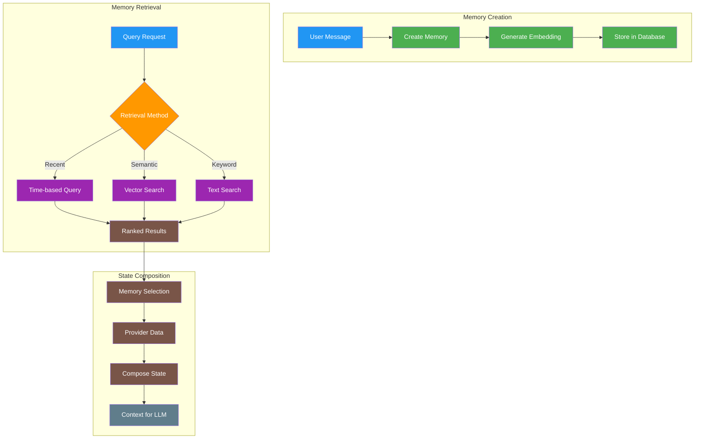

# a7046c18:packages_docs_agents_memory-and-state.mdx:1-150

**Commit:** a7046c1843f76b29f0432654f631f950f18a4390
**Author:** lalalune
**Date:** Thu Jan 8 23:05:40 2026 -0800
**File:** packages/docs/agents/memory-and-state.mdx:1-150
**Novelty Score:** 23659.22
**Concepts:** agent-system, authentication, blockchain, cache, containerization, documentation, embedded-db, event-driven, llm-integration, orchestration, performance, plugin-system, postgres, prompt-engineering, rag-system, rust-async, security, testing

```
---
title: 'Memory and State'
description: 'Understanding agent memory, context, and state management in elizaOS'
---

## Memory Architecture Overview

In elizaOS, memory and state management are core responsibilities of the `AgentRuntime`. The system provides a unified API for creating, storing, retrieving, and searching memories, enabling agents to maintain context and learn from interactions. For runtime details, see [Runtime and Lifecycle](/agents/runtime-and-lifecycle) and [Runtime Core](/runtime/core).



## Core Memory Concepts

### Memory Interface

Every piece of information an agent processes becomes a Memory:

```typescript
interface Memory {
  id?: UUID;                    // Unique identifier
  entityId: UUID;               // Who created this memory (user/agent)
  agentId?: UUID;               // Associated agent ID
  roomId: UUID;                 // Conversation context
  worldId?: UUID;               // Broader context (e.g., server)
  content: Content;             // The actual content
  embedding?: number[];         // Vector representation
  createdAt?: number;           // Timestamp (ms since epoch)
  unique?: boolean;             // Prevent duplicates
  similarity?: number;          // Similarity score (set on search)
  metadata?: MemoryMetadata;    // Additional data
}

interface Content {
  text?: string;               // Text content
  actions?: string[];          // Associated actions
  inReplyTo?: UUID;           // Reference to previous memory
  metadata?: any;             // Custom metadata
}
```

### Memory Lifecycle

#### 1. Creation

```typescript
// Creating a memory through the runtime
async function createMemory(runtime: IAgentRuntime, message: string) {
  const memory: Memory = {
    agentId: runtime.agentId,
    entityId: userId,
    roomId: currentRoom,
    content: {
      text: message,
      metadata: {
        source: 'chat',
        processed: Date.now()
      }
    }
  };

  // Runtime creates memory with table name and optional unique flag
  // Signature: createMemory(memory: Memory, tableName: string, unique?: boolean)
  const memoryId = await runtime.createMemory(memory, 'messages', true);
  return memoryId;
}
```

#### 2. Storage

Memories are persisted through the `IDatabaseAdapter`:

```typescript
// The runtime handles storage automatically
// Memories are stored with:
// - Full text for retrieval
// - Embeddings for semantic search
// - Metadata for filtering
// - Relationships for context
```

#### 3. Retrieval

```typescript
// Recent memories from a conversation
const recentMemories = await runtime.getMemories({
  roomId: roomId,
  count: 10,
  unique: true  // Deduplicate similar memories
});

// Memories from a specific user
const userMemories = await runtime.getMemories({
  entityId: userId,
  count: 20
});

// Time-bounded memories
const todaysMemories = await runtime.getMemories({
  roomId: roomId,
  start: startOfDay,
  end: endOfDay
});
```

## Context Management

### Context Window

The context window determines how much information the agent considers:

```typescript
// Context window configuration
export class AgentRuntime {
  readonly #conversationLength = 32; // Default messages to consider
```