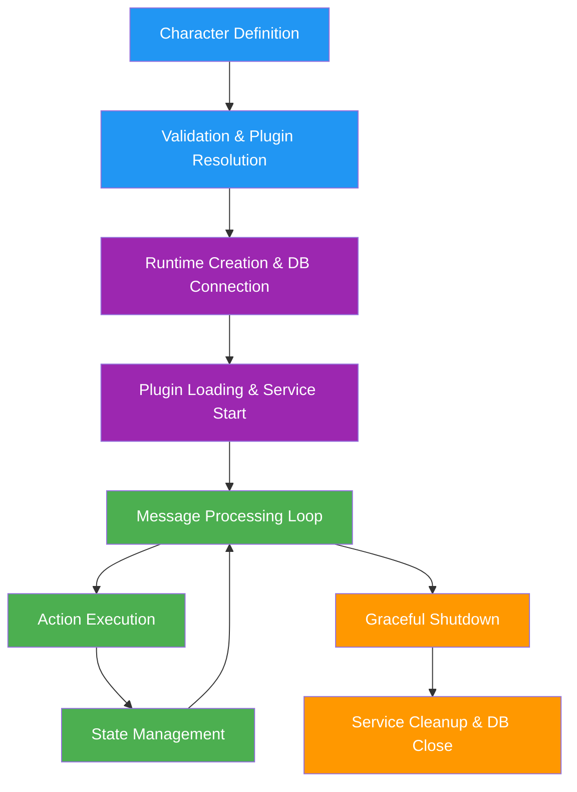

# a7046c18:packages_docs_agents_runtime-and-lifecycle.mdx:1-150

**Commit:** a7046c1843f76b29f0432654f631f950f18a4390
**Author:** lalalune
**Date:** Thu Jan 8 23:05:40 2026 -0800
**File:** packages/docs/agents/runtime-and-lifecycle.mdx:1-150
**Novelty Score:** 23659.22
**Concepts:** agent-system, authentication, blockchain, cache, containerization, documentation, embedded-db, event-driven, llm-integration, orchestration, performance, plugin-system, postgres, prompt-engineering, rag-system, rust-async, security, testing

```
---
title: 'Runtime and Lifecycle'
description: 'From Character configuration to live Agent execution in elizaOS'
---

## Agent Lifecycle Overview

The journey from a static Character configuration to a live, interactive Agent involves several distinct phases, each managed by the `AgentRuntime`. For character structure details, see [Character Interface](/agents/character-interface).



## Character to Agent Transformation

### Loading Characters

Characters can be loaded from various sources:

```typescript
// From TypeScript file
import { character } from './character';

// From JSON file
import characterJson from './character.json';

// From environment
const character = {
  name: process.env.AGENT_NAME || 'DefaultAgent',
  bio: process.env.AGENT_BIO || 'A helpful assistant',
  // ... other properties from env
};

// Dynamic loading
async function loadCharacter(source: string): Promise<Character> {
  if (source.endsWith('.json')) {
    const data = await fs.readFile(source, 'utf-8');
    return JSON.parse(data);
  } else if (source.endsWith('.ts')) {
    const module = await import(source);
    return module.character || module.default;
  } else if (source.startsWith('http')) {
    const response = await fetch(source);
    return await response.json();
  }
  
  throw new Error(`Unknown character source: ${source}`);
}
```

### Character Validation

Before creating an agent, the character must be validated:

```typescript
import { validateCharacter } from '@elizaos/core';

function validateAndPrepareCharacter(character: Partial<Character>): Character {
  // Required fields
  if (!character.name) {
    throw new Error('Character name is required');
  }
  
  if (!character.bio || (Array.isArray(character.bio) && character.bio.length === 0)) {
    throw new Error('Character bio is required');
  }
  
  // Set defaults
  const prepared: Character = {
    ...character,
    id: character.id || stringToUuid(character.name),
    username: character.username || character.name.toLowerCase().replace(/\s+/g, '_'),
    topics: character.topics || [],
    adjectives: character.adjectives || [],
    messageExamples: character.messageExamples || [],
    postExamples: character.postExamples || [],
    style: {
      all: character.style?.all || [],
      chat: character.style?.chat || [],
      post: character.style?.post || [],
    },
    settings: character.settings || {},
    secrets: character.secrets || {},
    plugins: character.plugins || [],
  };
  
  // Validate structure
  const validation = validateCharacter(prepared);
  if (!validation.valid) {
    throw new Error(`Character validation failed: ${validation.errors.join(', ')}`);
  }
  
  return prepared;
}
```

### Agent Instantiation

The transformation from Character to Agent:

```typescript
interface Agent extends Character {
  enabled?: boolean;
  status?: AgentStatus;
  createdAt: number;
  updatedAt: number;
}

enum AgentStatus {
  ACTIVE = 'active',
  INACTIVE = 'inactive',
}

// Creating an Agent from a Character
function createAgent(character: Character): Agent {
  return {
    ...character,
    enabled: true,
    status: AgentStatus.INACTIVE,  // Will become ACTIVE after initialization
    createdAt: Date.now(),
    updatedAt: Date.now()
  };
}
```

## Runtime Architecture

### AgentRuntime Core

The `AgentRuntime` is the central orchestrator:

```