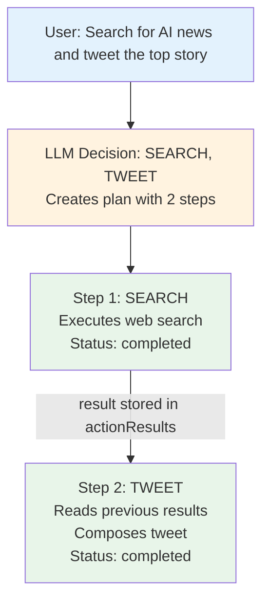

# a7046c18:packages_docs_guides_action-planning.mdx:1-150

**Commit:** a7046c1843f76b29f0432654f631f950f18a4390
**Author:** lalalune
**Date:** Thu Jan 8 23:05:40 2026 -0800
**File:** packages/docs/guides/action-planning.mdx:1-150
**Novelty Score:** 23659.22
**Concepts:** agent-system, authentication, blockchain, cache, containerization, documentation, embedded-db, event-driven, llm-integration, orchestration, performance, plugin-system, postgres, prompt-engineering, rag-system, rust-async, security, testing

```
---
title: "Multi-Step Action Planning"
description: "Execute complex workflows with action chaining and error recovery"
---

## The Problem

Simple agents can do one thing at a time. But real tasks are complex:

- "Search the web, summarize results, and tweet the highlights"
- "Check my calendar, find a free slot, and schedule a meeting"
- "Analyze this data, generate a chart, and email it to the team"

Each of these requires **multiple actions** executed in sequence, with results from one feeding into the next.

<Tip>
**Action planning lets your agent think in steps.** The LLM decides the sequence, and ElizaOS executes each action, passing results forward automatically.
</Tip>

## How It Works

When the LLM returns multiple actions, ElizaOS creates an **ActionPlan**:

```typescript
interface ActionPlan {
  thought: string;       // LLM's reasoning for this plan
  totalSteps: number;    // How many actions to execute
  currentStep: number;   // Which step we're on (0-indexed)
  steps: ActionPlanStep[];
}

interface ActionPlanStep {
  action: string;        // Action name (e.g., "SEARCH", "TWEET")
  status: 'pending' | 'completed' | 'failed';
  error?: string;        // If failed, why
  result?: ActionResult; // Output from this step
}
```

The plan flows through state, so each action can see what came before:



## Accessing Previous Results

In your action handler, access results from previous steps:

```typescript
const myAction: Action = {
  name: 'SUMMARIZE',
  description: 'Summarize the results from previous actions',

  async handler(runtime, message, state, options, callback) {
    // Get all previous action results
    const previousResults = state?.data?.actionResults || [];

    // Find specific action result
    const searchResult = previousResults.find(r => r.action === 'SEARCH');

    if (searchResult?.text) {
      // Use search results to generate summary
      const summary = await runtime.useModel(ModelType.TEXT_SMALL, {
        prompt: `Summarize this: ${searchResult.text}`
      });

      return {
        text: summary,
        action: 'SUMMARIZE',
        success: true
      };
    }

    return {
      text: 'No previous results to summarize',
      action: 'SUMMARIZE',
      success: false
    };
  }
};
```

## Accessing Plan State

The current action plan is available in `state.data.actionPlan`:

```typescript
async handler(runtime, message, state, options, callback) {
  const plan = state?.data?.actionPlan;

  if (plan) {
    console.log(`Step ${plan.currentStep + 1} of ${plan.totalSteps}`);
    console.log(`LLM reasoning: ${plan.thought}`);

    // Check previous steps
    for (const step of plan.steps) {
      if (step.status === 'completed') {
        console.log(`${step.action}: ${step.result?.text}`);
      } else if (step.status === 'failed') {
        console.log(`${step.action} failed: ${step.error}`);
      }
    }
  }

  // Your action logic...
}
```

## Error Handling in Plans

When a step fails, the plan continues by default. Handle failures gracefully:

```typescript
const resilientAction: Action = {
  name: 'PROCESS_DATA',

  async handler(runtime, message, state, options, callback) {
    const previousResults = state?.data?.actionResults || [];

    // Check if a required previous step failed
    const fetchResult = previousResults.find(r => r.action === 'FETCH_DATA');

    if (fetchResult?.success === false) {
      // Previous step failed - use fallback
      return {
        text: 'Using cached data due to fetch failure',
        action: 'PROCESS_DATA',
        success: true,
        data: { usedFallback: true }
      };
    }

    // Normal processing
    return {
      text: `Processed: ${fetchResult?.text}`,
      action: 'PROCESS_DATA',
```