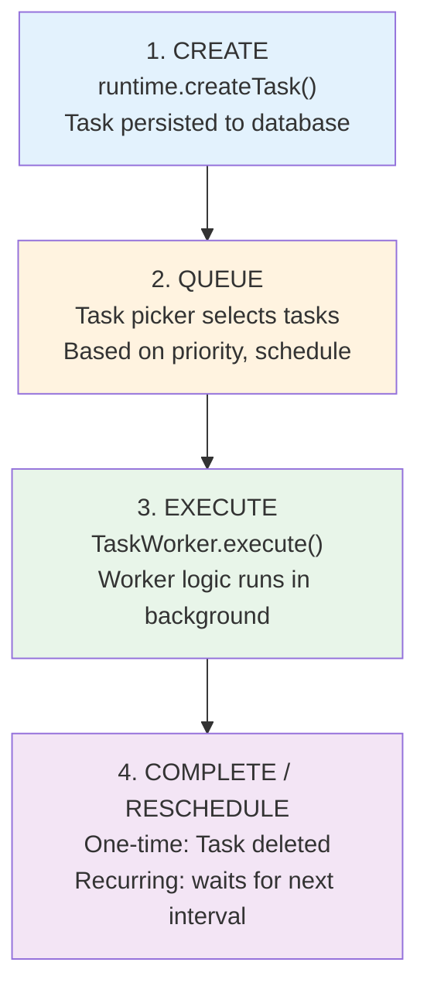

# a7046c18:packages_docs_guides_background-tasks.mdx:1-150

**Commit:** a7046c1843f76b29f0432654f631f950f18a4390
**Author:** lalalune
**Date:** Thu Jan 8 23:05:40 2026 -0800
**File:** packages/docs/guides/background-tasks.mdx:1-150
**Novelty Score:** 23659.22
**Concepts:** agent-system, authentication, blockchain, cache, containerization, documentation, embedded-db, event-driven, llm-integration, orchestration, performance, plugin-system, postgres, prompt-engineering, rag-system, rust-async, security, testing

```
---
title: "Background Tasks"
description: "Long-running and recurring operations with task workers"
---

## The Problem

Some operations take too long for a request/response cycle:

- Scraping a website every hour
- Processing a large file upload
- Syncing with external APIs periodically
- Generating weekly reports

Blocking the main thread kills responsiveness. Polling wastes resources.

<Tip>
**Task workers handle the heavy lifting.** Register a worker, create tasks, and ElizaOS executes them in the background with built-in persistence and scheduling.
</Tip>

## Quick Start

### 1. Define a Task Worker

```typescript
import type { TaskWorker } from '@elizaos/core';

const dataSync: TaskWorker = {
  name: 'SYNC_EXTERNAL_DATA',

  async execute(runtime, options, task) {
    const { sourceUrl, batchSize = 100 } = options;

    // Fetch data from external source
    const response = await fetch(sourceUrl);
    const data = await response.json();

    // Process in batches
    for (let i = 0; i < data.length; i += batchSize) {
      const batch = data.slice(i, i + batchSize);
      await processRecords(runtime, batch);
    }

    console.log(`Synced ${data.length} records from ${sourceUrl}`);
  },

  // Optional: validate before creating task
  async validate(runtime, message, state) {
    return message.content.text?.includes('sync');
  }
};
```

### 2. Register the Worker

```typescript
// In your plugin initialization
const plugin: Plugin = {
  name: 'my-sync-plugin',

  async init(runtime) {
    // Register the task worker
    runtime.registerTaskWorker(dataSync);
  }
};
```

### 3. Create Tasks

```typescript
// One-time task
const taskId = await runtime.createTask({
  name: 'SYNC_EXTERNAL_DATA',
  description: 'Sync user data from CRM',
  roomId: context.roomId,
  tags: ['sync', 'crm'],
  metadata: {
    sourceUrl: 'https://api.crm.com/users',
    batchSize: 50
  }
});

// Recurring task (runs every hour)
await runtime.createTask({
  name: 'SYNC_EXTERNAL_DATA',
  description: 'Hourly CRM sync',
  tags: ['sync', 'crm', 'scheduled'],
  metadata: {
    sourceUrl: 'https://api.crm.com/users',
    updateInterval: 60 * 60 * 1000  // 1 hour in ms
  }
});
```

## Task Lifecycle



## Task Types

### Task Interface

```typescript
interface Task {
  id?: UUID;                    // Auto-generated if not provided
  name: string;                 // Must match a registered TaskWorker.name
  description: string;          // Human-readable purpose
  roomId?: UUID;                // Associate with a room
  worldId?: UUID;               // Associate with a world
  entityId?: UUID;              // Associate with an entity
  tags: string[];               // For filtering and organization
  metadata?: TaskMetadata;      // Custom options and scheduling
  updatedAt?: number;           // Last execution timestamp
}
```

### Task Metadata

```typescript
type TaskMetadata = {
  // Scheduling
  updateInterval?: number;      // Recurring interval in ms

  // UI configuration (optional)
  options?: {
    name: string;
    description: string;
  }[];

  // Custom data (passed to execute())
  [key: string]: unknown;
};
```

### TaskWorker Interface
```