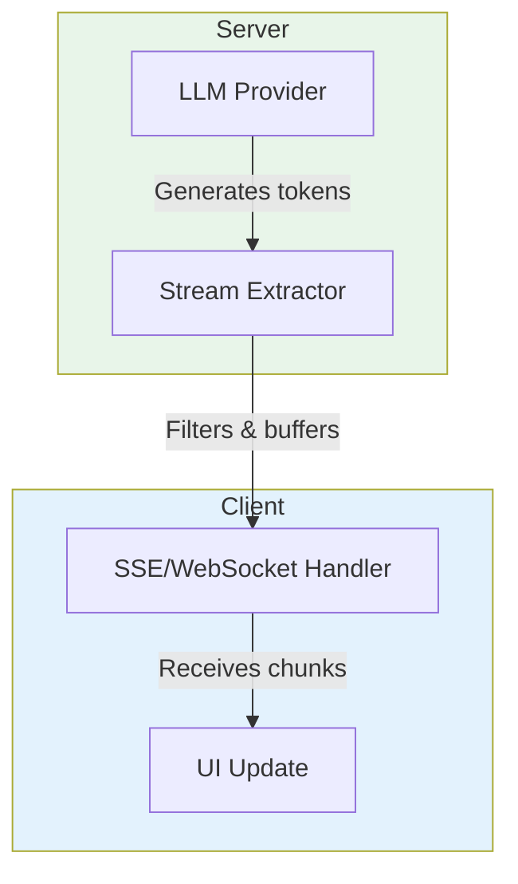

# a7046c18:packages_docs_guides_streaming-responses.mdx:151-295

**Commit:** a7046c1843f76b29f0432654f631f950f18a4390
**Author:** lalalune
**Date:** Thu Jan 8 23:05:40 2026 -0800
**File:** packages/docs/guides/streaming-responses.mdx:151-295
**Novelty Score:** 23659.22
**Concepts:** agent-system, authentication, blockchain, cache, containerization, documentation, embedded-db, event-driven, llm-integration, orchestration, performance, plugin-system, postgres, prompt-engineering, rag-system, rust-async, security, testing

```
const extractor = new XmlTagExtractor('text');

// LLM output: <response><text>Hello world!</text></response>
extractor.push('<response><text>Hello ');  // Returns: 'Hel' (keeps margin)
extractor.push('world!</text></response>'); // Returns: 'lo world!'
```

### ResponseStreamExtractor

Action-aware extraction used by DefaultMessageService. Understands `<actions>` to decide what to stream.

```typescript
import { ResponseStreamExtractor } from '@elizaos/core';

const extractor = new ResponseStreamExtractor();

// Only streams <text> when action is REPLY
extractor.push('<actions>REPLY</actions><text>Hello!');  // Returns: 'Hel'
extractor.push('</text>');                               // Returns: 'lo!'

// Skips <text> when action is something else (action handler will respond)
extractor.push('<actions>SEARCH</actions><text>Ignored</text>');  // Returns: ''
```

### Custom Extractor

Implement `IStreamExtractor` for custom filtering logic:

```typescript
import type { IStreamExtractor } from '@elizaos/core';

class JsonValueExtractor implements IStreamExtractor {
  private buffer = '';
  private _done = false;

  get done() { return this._done; }

  push(chunk: string): string {
    this.buffer += chunk;

    // Try to parse and extract "response" field
    try {
      const json = JSON.parse(this.buffer);
      this._done = true;
      return json.response || '';
    } catch {
      return ''; // Wait for complete JSON
    }
  }
}
```

## Stream Error Handling

The streaming system provides typed errors for robust handling:

```typescript
import { StreamError } from '@elizaos/core';

try {
  const result = extractor.push(hugeChunk);
} catch (error) {
  if (StreamError.isStreamError(error)) {
    switch (error.code) {
      case 'CHUNK_TOO_LARGE':
        console.error('Chunk exceeded 1MB limit');
        break;
      case 'BUFFER_OVERFLOW':
        console.error('Buffer exceeded 100KB');
        break;
      case 'PARSE_ERROR':
        console.error('Malformed content');
        break;
      case 'TIMEOUT':
        console.error('Stream timed out');
        break;
      case 'ABORTED':
        console.error('Stream was cancelled');
        break;
    }
  }
}
```

## Performance Tips

<CardGroup cols={2}>
  <Card title="Keep extractors simple" icon="bolt">
    Complex parsing logic in `push()` blocks the stream. Do heavy processing after streaming completes.
  </Card>
  <Card title="Use appropriate margins" icon="ruler">
    XML extractors keep a safety margin to avoid splitting closing tags. Default is 10 characters.
  </Card>
  <Card title="Handle backpressure" icon="gauge">
    If your UI can't keep up, chunks queue up in memory. Consider throttling or dropping old chunks.
  </Card>
  <Card title="Clean up resources" icon="trash">
    Call `extractor.reset()` between conversations to clear buffers and state.
  </Card>
</CardGroup>

## Architecture



**Data Flow:**
1. **LLM Provider** generates tokens via async iterator
2. **Stream Extractor** filters output, extracts streamable content, buffers for tag boundaries
3. **SSE/WebSocket** sends chunks to client progressively
4. **UI** updates in real-time as chunks arrive

## Next Steps

<CardGroup cols={2}>
  <Card title="Message Service" icon="comment" href="/runtime/services">
    Learn how DefaultMessageService uses streaming internally
  </Card>
  <Card title="Model Types" icon="brain" href="/runtime/models">
    Configure streaming behavior per model type
  </Card>
  <Card title="WebSocket API" icon="plug" href="/rest-reference/websocket/socketio-real-time-connection">
    Full WebSocket API reference
  </Card>
  <Card title="Types Reference" icon="code" href="/runtime/types-reference">
    Complete streaming type definitions
  </Card>
</CardGroup>
```