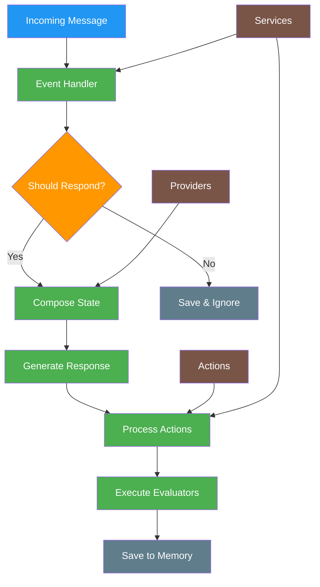

# a7046c18:packages_docs_plugin-registry_bootstrap_complete-documentation.mdx:1-150

**Commit:** a7046c1843f76b29f0432654f631f950f18a4390
**Author:** lalalune
**Date:** Thu Jan 8 23:05:40 2026 -0800
**File:** packages/docs/plugin-registry/bootstrap/complete-documentation.mdx:1-150
**Novelty Score:** 23659.22
**Concepts:** agent-system, authentication, blockchain, cache, containerization, documentation, embedded-db, event-driven, llm-integration, orchestration, performance, plugin-system, postgres, prompt-engineering, rag-system, rust-async, security, testing

```
---
title: "Complete Developer Guide"
description: "Comprehensive technical documentation for the bootstrap plugin's architecture, components, and implementation"
---


## Overview

The `@elizaos/plugin-bootstrap` package is the **core message handler** for elizaOS agents. It provides the fundamental event handlers, actions, providers, evaluators, and services that enable agents to process messages from any communication platform (Discord, Telegram, message bus server, etc.) and generate intelligent responses.

This plugin is essential for any elizaOS agent as it contains the core logic for:

- Processing incoming messages
- Determining whether to respond
- Generating contextual responses
- Managing agent actions
- Evaluating interactions
- Maintaining conversation state

## Architecture Overview



## Message Processing Flow

### 1. Message Reception

When a message arrives from any platform (Discord, Telegram, etc.), it triggers the `MESSAGE_RECEIVED` event, which is handled by the `messageReceivedHandler`.

### 2. Initial Processing

```typescript
const messageReceivedHandler = async ({
  runtime,
  message,
  callback,
  onComplete,
}: MessageReceivedHandlerParams): Promise<void> => {
  // 1. Generate unique response ID
  const responseId = v4();

  // 2. Track run lifecycle
  const runId = runtime.startRun();

  // 3. Save message to memory
  await Promise.all([
    runtime.addEmbeddingToMemory(message),
    runtime.createMemory(message, 'messages'),
  ]);

  // 4. Process attachments (images, documents)
  if (message.content.attachments) {
    message.content.attachments = await processAttachments(message.content.attachments, runtime);
  }

  // 5. Determine if agent should respond
  // 6. Generate response if needed
  // 7. Process actions
  // 8. Run evaluators
};
```

### 3. Should Respond Logic

The agent determines whether to respond based on:

- Room type (DMs always get responses)
- Agent state (muted/unmuted)
- Message content analysis
- Character configuration

### 4. Response Generation

If the agent decides to respond:

1. Compose state with relevant providers
2. Generate response using LLM
3. Parse XML response format
4. Execute actions
5. Send response via callback

## Core Components

### Event Handlers

Event handlers process different types of events in the system:

| Event Type               | Handler                   | Description                          |
| ------------------------ | ------------------------- | ------------------------------------ |
| `MESSAGE_RECEIVED`       | `messageReceivedHandler`  | Main message processing handler      |
| `VOICE_MESSAGE_RECEIVED` | `messageReceivedHandler`  | Handles voice messages               |
| `REACTION_RECEIVED`      | `reactionReceivedHandler` | Stores reactions in memory           |
| `MESSAGE_DELETED`        | `messageDeletedHandler`   | Removes deleted messages from memory |
| `CHANNEL_CLEARED`        | `channelClearedHandler`   | Clears all messages from a channel   |
| `POST_GENERATED`         | `postGeneratedHandler`    | Creates social media posts           |
| `WORLD_JOINED`           | `handleServerSync`        | Syncs server/world data              |
| `ENTITY_JOINED`          | `syncSingleUser`          | Syncs individual user data           |

### Actions

Actions define what an agent can do in response to messages:

#### Core Actions

1. **REPLY** (`reply.ts`)

   - Default response action
   - Generates contextual text responses
   - Can be used alone or chained with other actions

2. **IGNORE** (`ignore.ts`)

   - Explicitly ignores a message
   - Saves the ignore decision to memory
   - Used when agent decides not to respond

3. **NONE** (`none.ts`)
   - No-op action
   - Used as placeholder or default

#### Room Management Actions
```