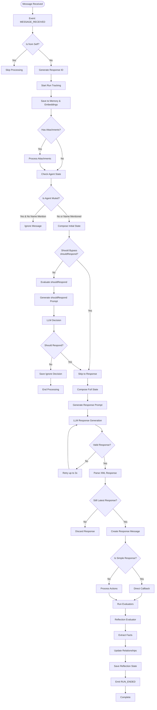

# a7046c18:packages_docs_plugin-registry_bootstrap_message-flow.mdx:1-150

**Commit:** a7046c1843f76b29f0432654f631f950f18a4390
**Author:** lalalune
**Date:** Thu Jan 8 23:05:40 2026 -0800
**File:** packages/docs/plugin-registry/bootstrap/message-flow.mdx:1-150
**Novelty Score:** 23659.22
**Concepts:** agent-system, authentication, blockchain, cache, containerization, documentation, embedded-db, event-driven, llm-integration, orchestration, performance, plugin-system, postgres, prompt-engineering, rag-system, rust-async, security, testing

```
---
title: "Message Processing Flow"
description: "Step-by-step breakdown of how messages flow through the bootstrap plugin system"
---

# Message Processing Flow - Detailed Breakdown

This document provides a step-by-step breakdown of how messages flow through the plugin-bootstrap system.

## Complete Message Flow Diagram



## Detailed Step Descriptions

### 1. Initial Message Reception

```typescript
// Event triggered by platform (Discord, Telegram, etc.)
EventType.MESSAGE_RECEIVED → messageReceivedHandler
```

### 2. Self-Check

```typescript
if (message.entityId === runtime.agentId) {
  logger.debug('Skipping message from self');
  return;
}
```

### 3. Response ID Generation

```typescript
// Prevents duplicate responses for rapid messages
const responseId = v4();
latestResponseIds.get(runtime.agentId).set(message.roomId, responseId);
```

### 4. Run Tracking

```typescript
const runId = runtime.startRun();
await runtime.emitEvent(EventType.RUN_STARTED, {...});
```

### 5. Memory Storage

```typescript
await Promise.all([
  runtime.addEmbeddingToMemory(message), // Vector embeddings
  runtime.createMemory(message, 'messages'), // Message history
]);
```

### 6. Attachment Processing

```typescript
if (message.content.attachments?.length > 0) {
  // Images: Generate descriptions
  // Documents: Extract text
  // Other: Process as configured
  message.content.attachments = await processAttachments(message.content.attachments, runtime);
}
```

### 7. Agent State Check

```typescript
const agentUserState = await runtime.getParticipantUserState(message.roomId, runtime.agentId);

if (
  agentUserState === 'MUTED' &&
  !message.content.text?.toLowerCase().includes(runtime.character.name.toLowerCase())
) {
  return; // Ignore if muted and not mentioned
}
```

### 8. Should Respond Evaluation

#### Bypass Conditions

```typescript
function shouldBypassShouldRespond(runtime, room, source) {
  // Default bypass types
  const bypassTypes = [ChannelType.DM, ChannelType.VOICE_DM, ChannelType.SELF, ChannelType.API];

  // Default bypass sources
  const bypassSources = ['client_chat'];

```