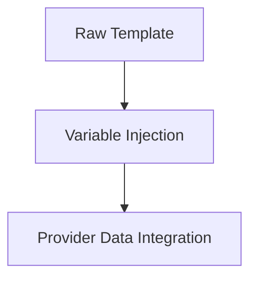

# a7046c18:packages_docs_plugin-registry_bootstrap_message-flow.mdx:301-450

**Commit:** a7046c1843f76b29f0432654f631f950f18a4390
**Author:** lalalune
**Date:** Thu Jan 8 23:05:40 2026 -0800
**File:** packages/docs/plugin-registry/bootstrap/message-flow.mdx:301-450
**Novelty Score:** 23659.22
**Concepts:** agent-system, authentication, blockchain, cache, containerization, documentation, embedded-db, event-driven, llm-integration, orchestration, performance, plugin-system, postgres, prompt-engineering, rag-system, rust-async, security, testing

```
- Only processes the latest message per room

### 2. Parallel Operations

```typescript
// Parallel memory operations
await Promise.all([
  runtime.addEmbeddingToMemory(message),
  runtime.createMemory(message, 'messages')
]);

// Parallel data fetching in providers
const [entities, room, messages, interactions] = await Promise.all([
  getEntityDetails({ runtime, roomId }),
  runtime.getRoom(roomId),
  runtime.getMemories({ tableName: 'messages', roomId }),
  getRecentInteractions(...)
]);
```

### 3. Timeout Protection

```typescript
const timeoutDuration = 60 * 60 * 1000; // 1 hour
await Promise.race([processingPromise, timeoutPromise]);
```

## Error Handling

### 1. Run Lifecycle Events

```typescript
try {
  // Process message
  await runtime.emitEvent(EventType.RUN_ENDED, { status: 'completed' });
} catch (error) {
  await runtime.emitEvent(EventType.RUN_ENDED, {
    status: 'error',
    error: error.message,
  });
}
```

### 2. Graceful Degradation

- Missing attachments → Continue without them
- Provider errors → Use default values
- LLM failures → Retry with backoff
- Database errors → Log and continue

## Platform-Specific Handling

### Discord

- Channels → Rooms with ChannelType
- Servers → Worlds
- Users → Entities

### Telegram

- Chats → Rooms
- Groups → Worlds
- Users → Entities

### Message Bus

- Topics → Rooms
- Namespaces → Worlds
- Publishers → Entities

## Summary

The message flow through plugin-bootstrap is designed to be:

1. **Platform-agnostic** - Works with any message source
2. **Intelligent** - Makes context-aware response decisions
3. **Extensible** - Supports custom actions, providers, evaluators
4. **Resilient** - Handles errors gracefully
5. **Performant** - Uses parallel operations and caching

This flow ensures that every message is processed consistently, responses are contextual and appropriate, and the agent learns from each interaction.

## Template Usage in Message Flow

Understanding where templates are used helps you customize the right parts of the flow:

### 1. **shouldRespondTemplate** - Decision Point

Used at step 8 in the flow when evaluating whether to respond:

```
Message Received → shouldRespondTemplate → RESPOND/IGNORE/STOP
```

This template controls:

- When your agent engages in conversations
- What triggers a response
- When to stay silent

### 2. **messageHandlerTemplate** - Response Generation

Used at step 9 when generating the actual response:

```
Decision to Respond → messageHandlerTemplate → Response + Actions
```

This template controls:

- How responses are formulated
- Which actions are selected
- The agent's personality and tone
- Which providers to use for context

### 3. **reflectionTemplate** - Post-Interaction Analysis

Used at step 12 during evaluator execution:

```
Response Sent → reflectionTemplate → Learning & Memory Updates
```

This template controls:

- What the agent learns from interactions
- How facts are extracted
- Relationship tracking logic
- Self-improvement mechanisms

### 4. **postCreationTemplate** - Social Media Posts

Used when POST_GENERATED event is triggered:

```
Post Request → postCreationTemplate → Social Media Content
```

This template controls:

- Post style and tone
- Content generation approach
- Image prompt generation

### Template Processing Pipeline

