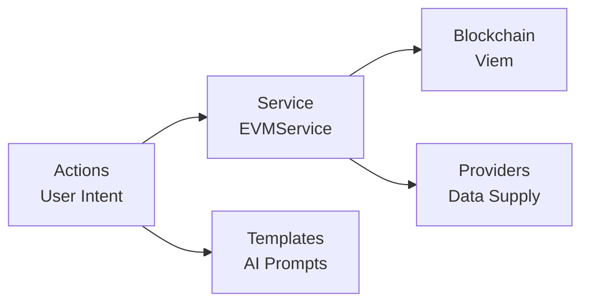

# a7046c18:packages_docs_plugin-registry_defi_evm_complete-documentation.mdx:1-150

**Commit:** a7046c1843f76b29f0432654f631f950f18a4390
**Author:** lalalune
**Date:** Thu Jan 8 23:05:40 2026 -0800
**File:** packages/docs/plugin-registry/defi/evm/complete-documentation.mdx:1-150
**Novelty Score:** 23659.22
**Concepts:** agent-system, authentication, blockchain, cache, containerization, documentation, embedded-db, event-driven, llm-integration, orchestration, performance, plugin-system, postgres, prompt-engineering, rag-system, rust-async, security, testing

```
---
title: "Developer Guide"
description: "Comprehensive guide to the EVM plugin architecture, implementation, and usage"
---

This guide provides an in-depth look at the EVM plugin's architecture, components, and implementation details.

## Architecture Overview

The EVM plugin follows a modular architecture with clear separation of concerns:



## Core Components

### EVMService

The central service that manages blockchain connections and wallet data:

```typescript
export class EVMService extends Service {
  static serviceType = 'evm-service';
  
  private walletProvider: WalletProvider;
  private intervalId: NodeJS.Timeout | null = null;

  async initialize(runtime: IAgentRuntime): Promise<void> {
    // Initialize wallet provider with chain configuration
    this.walletProvider = await initWalletProvider(runtime);
    
    // Set up periodic balance refresh
    this.intervalId = setInterval(
      () => this.refreshWalletData(),
      60000 // 1 minute
    );
  }

  async refreshWalletData(): Promise<void> {
    await this.walletProvider.getChainConfigs();
    // Update cached balance data
  }
}
```

### Actions

#### Transfer Action

Handles native and ERC20 token transfers:

```typescript
export const transferAction: Action = {
  name: 'EVM_TRANSFER',
  description: 'Transfer tokens on EVM chains',
  
  validate: async (runtime: IAgentRuntime) => {
    const privateKey = runtime.getSetting('EVM_PRIVATE_KEY');
    return !!privateKey || runtime.getSetting('WALLET_PUBLIC_KEY');
  },

  handler: async (runtime, message, state, options, callback) => {
    // 1. Extract parameters using AI
    const params = await extractTransferParams(runtime, message, state);
    
    // 2. Validate inputs
    if (!isAddress(params.toAddress)) {
      throw new Error('Invalid recipient address');
    }
    
    // 3. Execute transfer
    const result = await executeTransfer(params);
    
    // 4. Return response
    callback?.({
      text: `Transferred ${params.amount} ${params.token} to ${params.toAddress}`,
      content: { hash: result.hash }
    });
  }
};
```

#### Swap Action

Integrates with multiple DEX aggregators:

```typescript
export const swapAction: Action = {
  name: 'EVM_SWAP',
  description: 'Swap tokens on the same chain',
  
  handler: async (runtime, message, state, options, callback) => {
    // 1. Extract swap parameters
    const params = await extractSwapParams(runtime, message, state);
    
    // 2. Get quotes from aggregators
    const quotes = await Promise.all([
      getLiFiQuote(params),
      getBebopQuote(params)
    ]);
    
    // 3. Select best route
    const bestQuote = selectBestQuote(quotes);
    
    // 4. Execute swap
    const result = await executeSwap(bestQuote);
    
    callback?.({
      text: `Swapped ${params.fromAmount} ${params.fromToken} for ${result.toAmount} ${params.toToken}`,
      content: result
    });
  }
};
```

#### Bridge Action

Cross-chain token transfers using LiFi:

```typescript
export const bridgeAction: Action = {
  name: 'EVM_BRIDGE',
  description: 'Bridge tokens across chains',
  
  handler: async (runtime, message, state, options, callback) => {
    const params = await extractBridgeParams(runtime, message, state);
    
    // Get bridge route
    const route = await lifi.getRoutes({
      fromChainId: params.fromChain,
      toChainId: params.toChain,
      fromTokenAddress: params.fromToken,
      toTokenAddress: params.toToken,
      fromAmount: params.amount
    });
    
    // Execute bridge transaction
    const result = await lifi.executeRoute(route.routes[0]);
    
    callback?.({
      text: `Bridging ${params.amount} from ${params.fromChain} to ${params.toChain}`,
      content: { hash: result.hash, route: route.routes[0] }
    });
  }
```