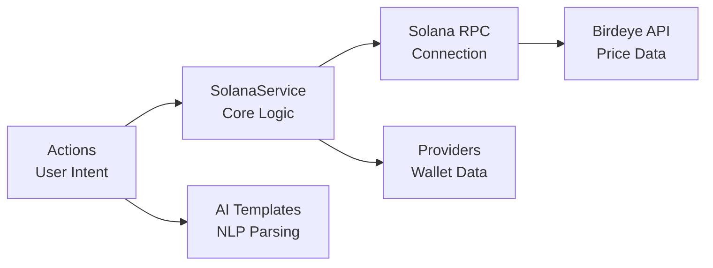

# a7046c18:packages_docs_plugin-registry_defi_solana_complete-documentation.mdx:1-150

**Commit:** a7046c1843f76b29f0432654f631f950f18a4390
**Author:** lalalune
**Date:** Thu Jan 8 23:05:40 2026 -0800
**File:** packages/docs/plugin-registry/defi/solana/complete-documentation.mdx:1-150
**Novelty Score:** 23659.22
**Concepts:** agent-system, authentication, blockchain, cache, containerization, documentation, embedded-db, event-driven, llm-integration, orchestration, performance, plugin-system, postgres, prompt-engineering, rag-system, rust-async, security, testing

```
---
title: "Developer Guide"
description: "In-depth technical documentation for the Solana blockchain plugin"
---

This guide provides comprehensive documentation of the Solana plugin's architecture, implementation, and advanced features.

## Architecture Overview

The Solana plugin follows a modular architecture optimized for high-performance blockchain interactions:



## Core Components

### SolanaService

The central service managing all Solana blockchain interactions:

```typescript
export class SolanaService extends Service {
  static serviceType = 'solana-service';
  
  private connection: Connection;
  private keypair?: Keypair;
  private wallet?: Wallet;
  private cache: Map<string, { data: any; timestamp: number }> = new Map();
  private subscriptions: number[] = [];

  async initialize(runtime: IAgentRuntime): Promise<void> {
    // Initialize connection
    const rpcUrl = runtime.getSetting('SOLANA_RPC_URL') || 'https://api.mainnet-beta.solana.com';
    this.connection = new Connection(rpcUrl, {
      commitment: 'confirmed',
      wsEndpoint: rpcUrl.replace('https', 'wss')
    });

    // Initialize wallet
    const privateKey = runtime.getSetting('SOLANA_PRIVATE_KEY');
    if (privateKey) {
      this.keypair = await loadKeypair(privateKey);
      this.wallet = new Wallet(this.keypair);
    }

    // Start portfolio monitoring
    this.startPortfolioTracking();
    
    // Register with trader service if available
    this.registerWithTraderService(runtime);
  }

  private async startPortfolioTracking(): Promise<void> {
    // Initial fetch
    await this.fetchPortfolioData();
    
    // Set up periodic refresh (2 minutes)
    setInterval(() => this.fetchPortfolioData(), 120000);
    
    // Set up WebSocket subscriptions
    if (this.keypair) {
      this.setupAccountSubscriptions();
    }
  }
}
```

### Actions

#### Transfer Action

Handles SOL and SPL token transfers with intelligent parsing:

```typescript
export const transferAction: Action = {
  name: 'TRANSFER_SOLANA',
  description: 'Transfer SOL or SPL tokens on Solana',
  
  validate: async (runtime: IAgentRuntime) => {
    const privateKey = runtime.getSetting('SOLANA_PRIVATE_KEY');
    return !!privateKey;
  },

  handler: async (runtime, message, state, options, callback) => {
    try {
      // Extract parameters using AI
      const params = await extractTransferParams(runtime, message, state);
      
      // Get service instance
      const service = runtime.getService<SolanaService>('solana-service');
      
      // Execute transfer
      const result = await executeTransfer(service, params);
      
      callback?.({
        text: `Successfully transferred ${params.amount} ${params.token} to ${params.recipient}`,
        content: {
          success: true,
          signature: result.signature,
          amount: params.amount,
          token: params.token,
          recipient: params.recipient
        }
      });
    } catch (error) {
      callback?.({
        text: `Transfer failed: ${error.message}`,
        content: { error: error.message }
      });
    }
  },

  examples: [
    [
      {
        name: 'user',
        content: { text: 'Send 1 SOL to 7xKXtg2CW87d97TXJSDpbD5jBkheTqA83TZRuJosgAsU' }
      },
      {
        name: 'assistant',
        content: { text: "I'll send 1 SOL to that address right away." }
      }
    ]
  ],

  similes: ['SEND_SOL', 'SEND_TOKEN_SOLANA', 'TRANSFER_SOL', 'PAY_SOL']
};
```

#### Swap Action

Token swapping using Jupiter aggregator:

```typescript
export const swapAction: Action = {
  name: 'SWAP_SOLANA',
  description: 'Swap tokens on Solana using Jupiter',
  
  handler: async (runtime, message, state, options, callback) => {
    // Extract swap parameters
    const params = await extractSwapParams(runtime, message, state);
    
    // Get Jupiter quote
```