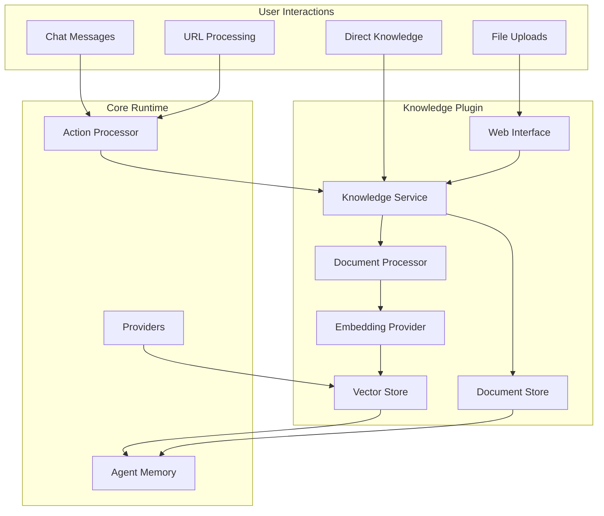
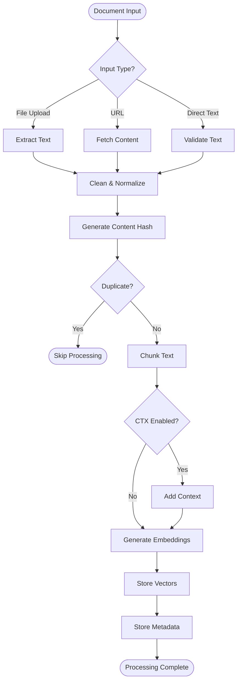
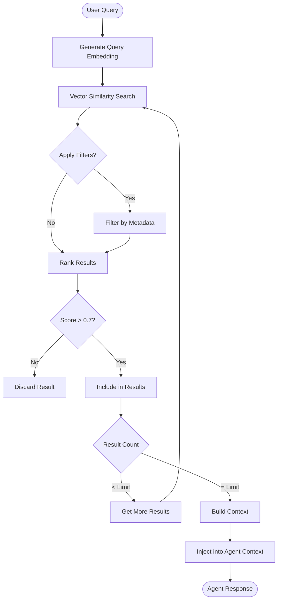
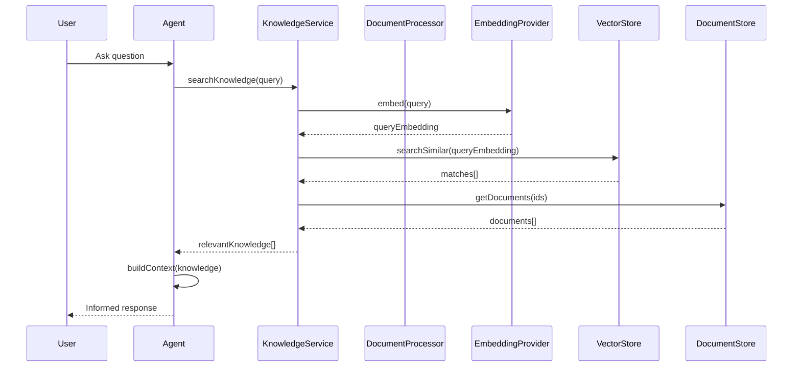
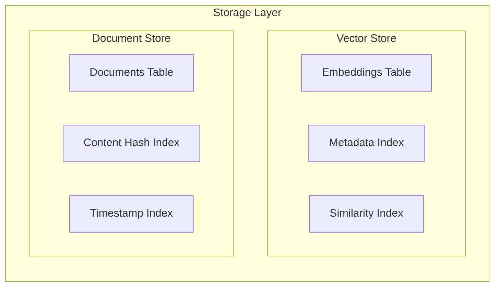

# a7046c18:packages_docs_plugin-registry_knowledge_architecture-flow.mdx:1-150

**Commit:** a7046c1843f76b29f0432654f631f950f18a4390
**Author:** lalalune
**Date:** Thu Jan 8 23:05:40 2026 -0800
**File:** packages/docs/plugin-registry/knowledge/architecture-flow.mdx:1-150
**Novelty Score:** 23659.22
**Concepts:** agent-system, authentication, blockchain, cache, containerization, documentation, embedded-db, event-driven, llm-integration, orchestration, performance, plugin-system, postgres, prompt-engineering, rag-system, rust-async, security, testing

```
---
title: Architecture & Flow Diagrams
description: Visual guide to the Knowledge plugin's internal architecture and data flows
---

This guide provides detailed visual representations of the Knowledge plugin's architecture, processing flows, and component interactions.

## High-Level Architecture



## Document Processing Flow



## Retrieval Flow



## Component Interactions



## Data Flow Architecture

