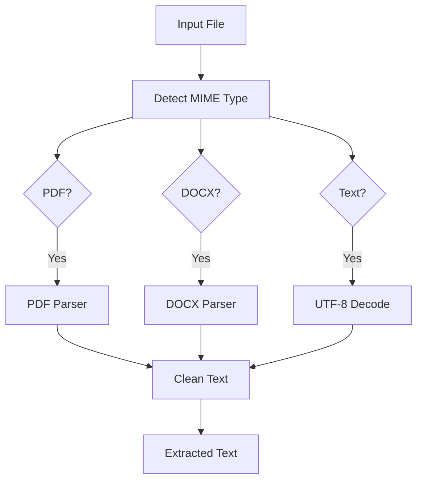
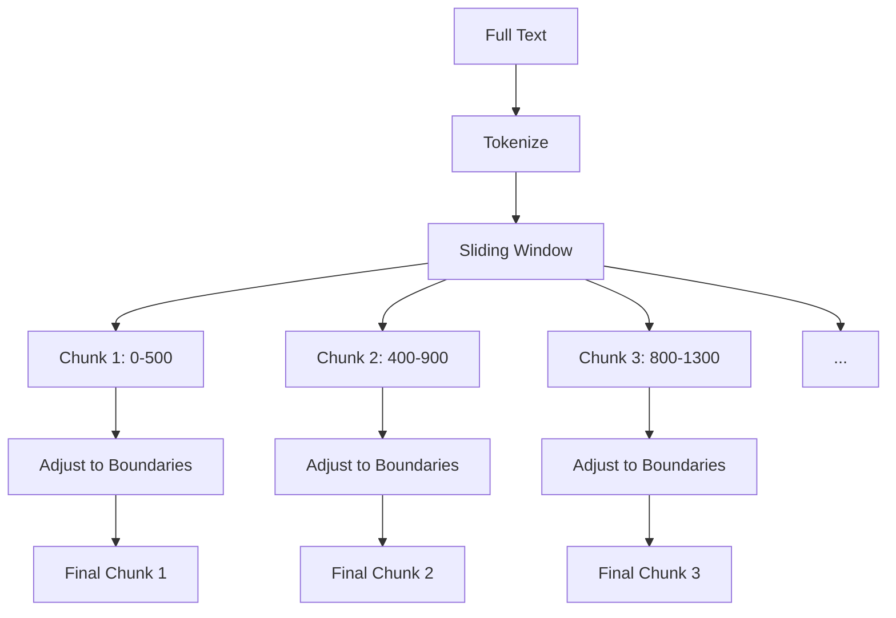
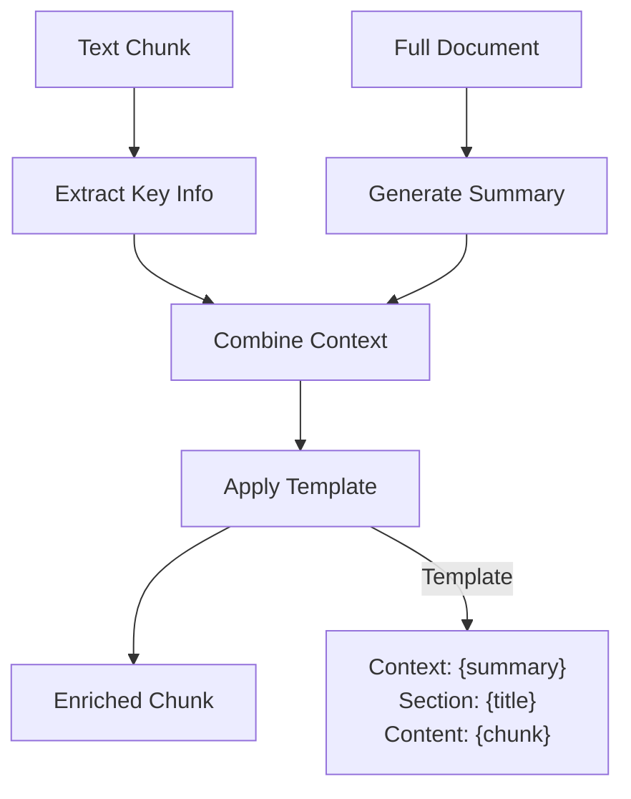
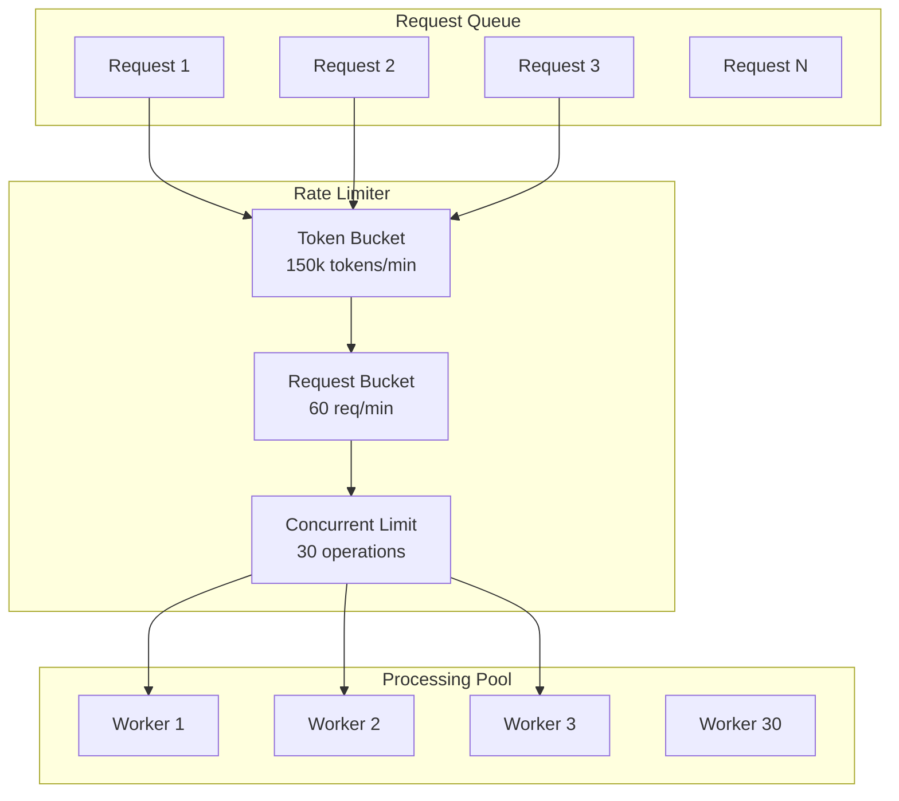
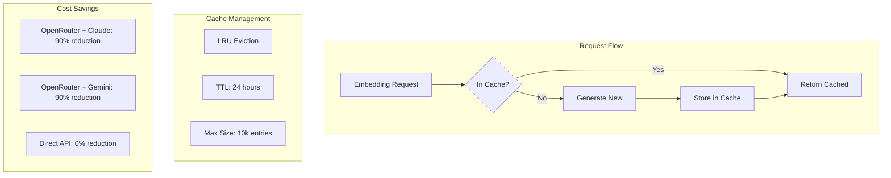
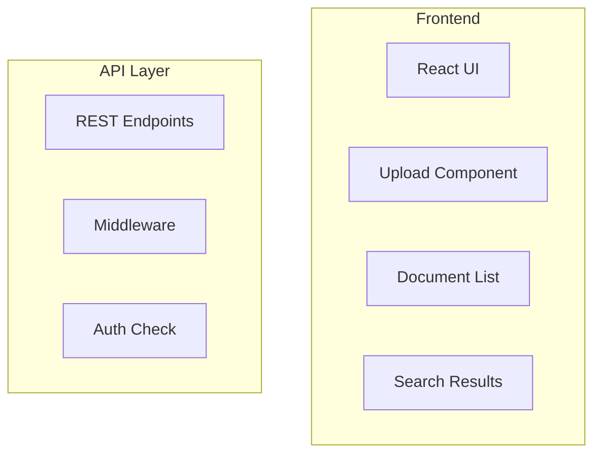

# a7046c18:packages_docs_plugin-registry_knowledge_architecture-flow.mdx:151-300

**Commit:** a7046c1843f76b29f0432654f631f950f18a4390
**Author:** lalalune
**Date:** Thu Jan 8 23:05:40 2026 -0800
**File:** packages/docs/plugin-registry/knowledge/architecture-flow.mdx:151-300
**Novelty Score:** 23659.22
**Concepts:** agent-system, authentication, blockchain, cache, containerization, documentation, embedded-db, event-driven, llm-integration, orchestration, performance, plugin-system, postgres, prompt-engineering, rag-system, rust-async, security, testing

```
    
    subgraph "Memory Types"
        M1[Document Memory]
        M2[Fragment Memory]
        M3[Context Memory]
    end
    
    VS1 --> M2
    DS1 --> M1
    M1 --> M3
    M2 --> M3
```

## Processing Pipeline Details

### Text Extraction Flow



### Chunking Strategy



### Contextual Enrichment



## Rate Limiting & Concurrency



## Caching Architecture



## Web Interface Architecture

