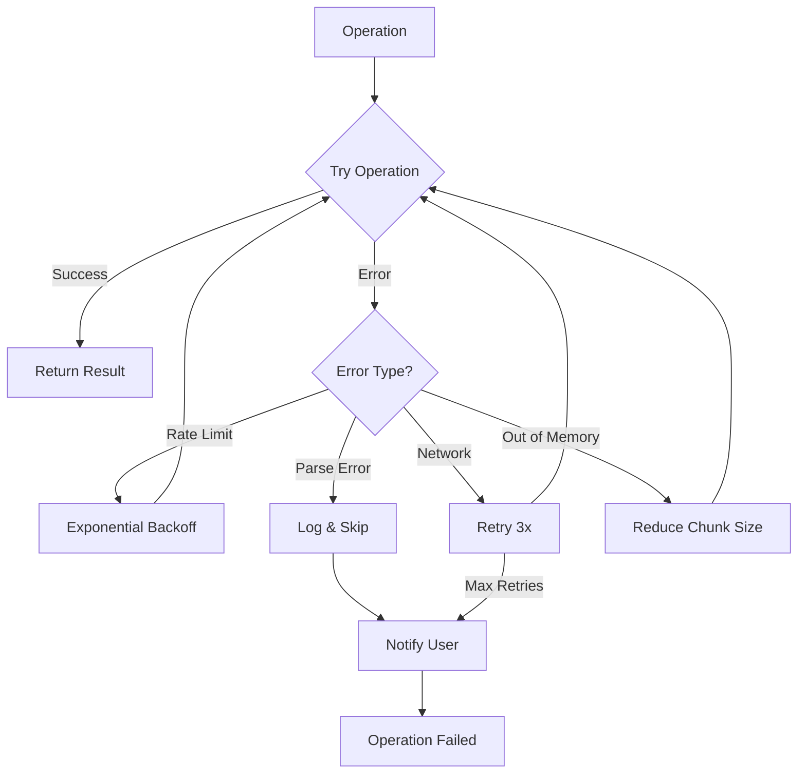
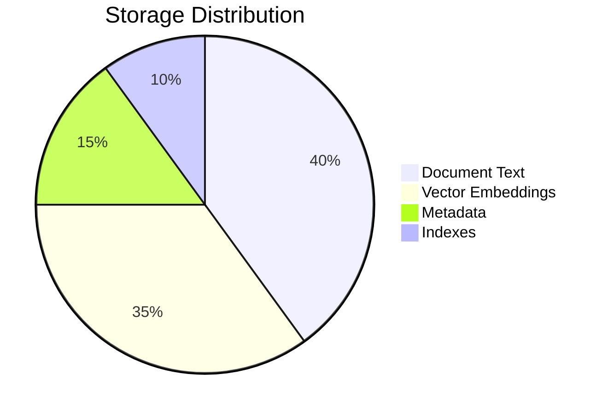
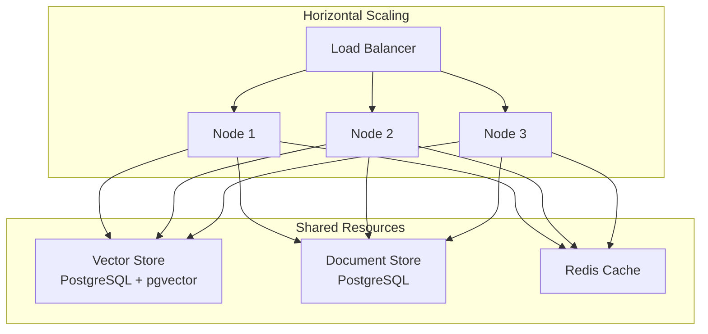

# a7046c18:packages_docs_plugin-registry_knowledge_architecture-flow.mdx:301-439

**Commit:** a7046c1843f76b29f0432654f631f950f18a4390
**Author:** lalalune
**Date:** Thu Jan 8 23:05:40 2026 -0800
**File:** packages/docs/plugin-registry/knowledge/architecture-flow.mdx:301-439
**Novelty Score:** 23659.22
**Concepts:** agent-system, authentication, blockchain, cache, containerization, documentation, embedded-db, event-driven, llm-integration, orchestration, performance, plugin-system, postgres, prompt-engineering, rag-system, rust-async, security, testing

```
    subgraph "Backend"
        KS[Knowledge Service]
        FS[File Storage]
        PS[Processing Queue]
    end
    
    UI --> REST
    UP --> REST
    DL --> REST
    SR --> REST
    
    REST --> MW
    MW --> Auth
    Auth --> KS
    
    KS --> FS
    KS --> PS
```

## Error Handling Flow



## Performance Characteristics

### Processing Times

```mermaid
gantt
    title Document Processing Timeline
    dateFormat X
    axisFormat %s
    
    section Small Doc (< 1MB)
    Text Extraction     :0, 1
    Chunking           :1, 2
    Embedding          :2, 5
    Storage            :5, 6
    
    section Medium Doc (1-10MB)
    Text Extraction     :0, 3
    Chunking           :3, 5
    Embedding          :5, 15
    Storage            :15, 17
    
    section Large Doc (10-50MB)
    Text Extraction     :0, 10
    Chunking           :10, 15
    Embedding          :15, 45
    Storage            :45, 50
```



### Storage Requirements



## Scaling Considerations



## Summary

The Knowledge plugin's architecture is designed for:

<CardGroup cols={2}>
  <Card title="Scalability" icon="chart-line">
    Handles large document collections efficiently
  </Card>
  <Card title="Performance" icon="gauge-max">
    Optimized processing and retrieval paths
  </Card>
  <Card title="Reliability" icon="shield-check">
    Robust error handling and recovery
  </Card>
  <Card title="Cost Efficiency" icon="dollar-sign">
    90% savings with intelligent caching
  </Card>
</CardGroup>

Understanding these flows helps you:
- Optimize configuration for your use case
- Debug issues effectively
- Plan for scale
- Integrate with other systems
```