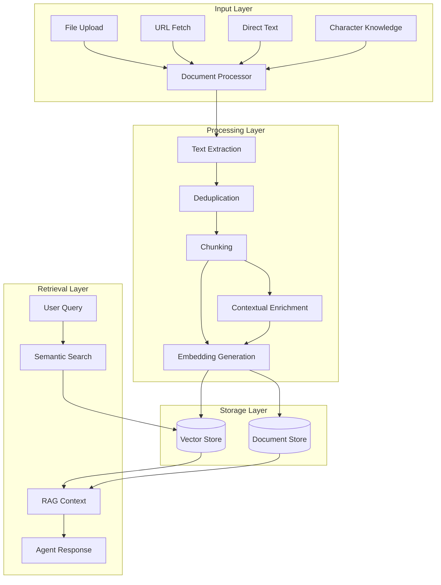

# a7046c18:packages_docs_plugin-registry_knowledge_complete-documentation.mdx:1-150

**Commit:** a7046c1843f76b29f0432654f631f950f18a4390
**Author:** lalalune
**Date:** Thu Jan 8 23:05:40 2026 -0800
**File:** packages/docs/plugin-registry/knowledge/complete-documentation.mdx:1-150
**Novelty Score:** 23659.22
**Concepts:** agent-system, authentication, blockchain, cache, containerization, documentation, embedded-db, event-driven, llm-integration, orchestration, performance, plugin-system, postgres, prompt-engineering, rag-system, rust-async, security, testing

```
---
title: Complete Developer Guide
description: Comprehensive technical reference for the Knowledge plugin
---

The `@elizaos/plugin-knowledge` package provides Retrieval Augmented Generation (RAG) capabilities for elizaOS agents. It enables agents to store, search, and automatically use knowledge from uploaded documents and text.

## Key Features

- **Multi-format Support**: Process PDFs, Word docs, text files, and more
- **Smart Deduplication**: Content-based IDs prevent duplicate entries
- **Automatic RAG**: Knowledge is automatically injected into relevant conversations
- **Character Knowledge**: Load knowledge from character definitions
- **REST API**: Manage documents via HTTP endpoints
- **Conversation Tracking**: Track which knowledge was used in responses

## Architecture Overview



## Core Components

### Knowledge Service

The main service class that handles all knowledge operations:

```typescript
class KnowledgeService extends Service {
  static readonly serviceType = 'knowledge';
  private knowledgeConfig: KnowledgeConfig;
  private knowledgeProcessingSemaphore: Semaphore;

  constructor(runtime: IAgentRuntime, config?: Partial<KnowledgeConfig>) {
    super(runtime);
    this.knowledgeProcessingSemaphore = new Semaphore(10);

    // Configuration with environment variable support
    this.knowledgeConfig = {
      CTX_KNOWLEDGE_ENABLED: parseBooleanEnv(config?.CTX_KNOWLEDGE_ENABLED),
      LOAD_DOCS_ON_STARTUP: loadDocsOnStartup,
      MAX_INPUT_TOKENS: config?.MAX_INPUT_TOKENS,
      MAX_OUTPUT_TOKENS: config?.MAX_OUTPUT_TOKENS,
      EMBEDDING_PROVIDER: config?.EMBEDDING_PROVIDER,
      TEXT_PROVIDER: config?.TEXT_PROVIDER,
      TEXT_EMBEDDING_MODEL: config?.TEXT_EMBEDDING_MODEL,
    };

    // Auto-load documents on startup if enabled
    if (this.knowledgeConfig.LOAD_DOCS_ON_STARTUP) {
      this.loadInitialDocuments();
    }
  }

  // Main public method for adding knowledge
  async addKnowledge(options: AddKnowledgeOptions): Promise<{
    clientDocumentId: string;
    storedDocumentMemoryId: UUID;
    fragmentCount: number;
  }> {
    // Generate content-based ID for deduplication
    const contentBasedId = generateContentBasedId(options.content, agentId, {
      includeFilename: options.originalFilename,
      contentType: options.contentType,
      maxChars: 2000,
    });

    // Check for duplicates
    const existingDocument = await this.runtime.getMemoryById(contentBasedId);
    if (existingDocument) {
      // Return existing document info
      return { clientDocumentId: contentBasedId, ... };
    }

    // Process new document
    return this.processDocument({ ...options, clientDocumentId: contentBasedId });
  }

  // Semantic search for knowledge
  async getKnowledge(
    message: Memory,
    scope?: { roomId?: UUID; worldId?: UUID; entityId?: UUID }
  ): Promise<KnowledgeItem[]> {
    const embedding = await this.runtime.useModel(ModelType.TEXT_EMBEDDING, {
      text: message.content.text,
    });

    const fragments = await this.runtime.searchMemories({
      tableName: 'knowledge',
      embedding,
      query: message.content.text,
      ...scope,
      count: 20,
      match_threshold: 0.1,
    });

    return fragments.map(fragment => ({
      id: fragment.id,
      content: fragment.content,
      similarity: fragment.similarity,
      metadata: fragment.metadata,
    }));
  }

  // RAG metadata enrichment for conversation tracking
  async enrichConversationMemoryWithRAG(
    memoryId: UUID,
    ragMetadata: {
      retrievedFragments: Array<{
        fragmentId: UUID;
        documentTitle: string;
        similarityScore?: number;
        contentPreview: string;
      }>;
      queryText: string;
      totalFragments: number;
      retrievalTimestamp: number;
    }
  ): Promise<void> {
    // Enriches conversation memories with RAG usage data
  }
```