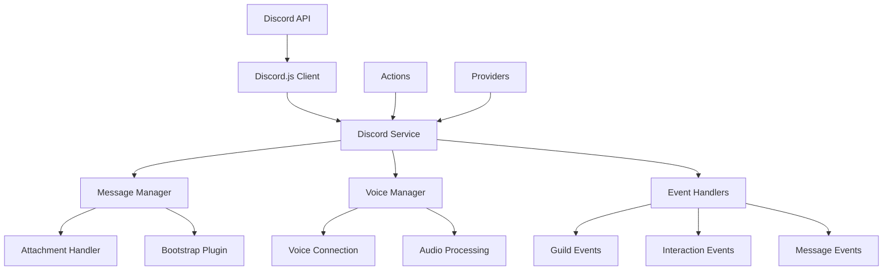

# a7046c18:packages_docs_plugin-registry_platform_discord_developer-guide.mdx:1-150

**Commit:** a7046c1843f76b29f0432654f631f950f18a4390
**Author:** lalalune
**Date:** Thu Jan 8 23:05:40 2026 -0800
**File:** packages/docs/plugin-registry/platform/discord/developer-guide.mdx:1-150
**Novelty Score:** 23659.22
**Concepts:** agent-system, authentication, blockchain, cache, containerization, documentation, embedded-db, event-driven, llm-integration, orchestration, performance, plugin-system, postgres, prompt-engineering, rag-system, rust-async, security, testing

```
---
title: "Developer Guide"
description: "Comprehensive Discord integration for elizaOS agents. It enables agents to operate as fully-featured Discord bots with advanced features and capabilities."
---

## Overview

The `@elizaos/plugin-discord` package provides comprehensive Discord integration for elizaOS agents. It enables agents to operate as fully-featured Discord bots with support for text channels, voice channels, direct messages, slash commands, and media processing.

This plugin handles all Discord-specific functionality including:
- Initializing and managing the Discord bot connection
- Processing messages and interactions across multiple servers
- Managing voice channel connections and audio processing
- Handling media attachments and transcription
- Implementing Discord-specific actions and state providers
- Supporting channel restrictions and permission management

## Architecture Overview



## Core Components

### Discord Service

The `DiscordService` class is the main entry point for Discord functionality:

```typescript
export class DiscordService extends Service implements IDiscordService {
  static serviceType: string = DISCORD_SERVICE_NAME;
  client: DiscordJsClient | null;
  character: Character;
  messageManager?: MessageManager;
  voiceManager?: VoiceManager;
  private allowedChannelIds?: string[];
  
  constructor(runtime: IAgentRuntime) {
    super(runtime);
    // Initialize Discord client with proper intents
    // Set up event handlers
    // Parse channel restrictions
  }
}
```

#### Key Responsibilities:

1. **Client Initialization**
   - Creates Discord.js client with required intents
   - Handles authentication with bot token
   - Manages connection lifecycle

2. **Event Registration**
   - Listens for Discord events (messages, interactions, etc.)
   - Routes events to appropriate handlers
   - Manages event cleanup on disconnect

3. **Channel Restrictions**
   - Parses `CHANNEL_IDS` environment variable
   - Enforces channel-based access control
   - Filters messages based on allowed channels

4. **Component Coordination**
   - Initializes MessageManager and VoiceManager
   - Coordinates between different components
   - Manages shared state and resources

### Message Manager

The `MessageManager` class handles all message-related operations:

```typescript
export class MessageManager {
  private client: DiscordJsClient;
  private runtime: IAgentRuntime;
  private inlinePositionalCallbacks: Map<string, (message: DiscordMessage, args: string) => void>;
  
  async handleMessage(message: DiscordMessage): Promise<void> {
    // Convert Discord message to elizaOS format
    // Process attachments
    // Send to bootstrap plugin
    // Handle response
  }
  
  async processAttachments(message: DiscordMessage): Promise<Content[]> {
    // Download and process media files
    // Generate descriptions for images
    // Transcribe audio/video
  }
}
```

#### Message Processing Flow:

1. **Message Reception**
   ```typescript
   // Discord message received
   if (message.author.bot) return; // Ignore bot messages
   if (!this.shouldProcessMessage(message)) return;
   ```

2. **Format Conversion**
   ```typescript
   const elizaMessage = await this.convertMessage(message);
   elizaMessage.channelId = message.channel.id;
   elizaMessage.serverId = message.guild?.id;
   ```

3. **Attachment Processing**
   ```typescript
   if (message.attachments.size > 0) {
     elizaMessage.attachments = await this.processAttachments(message);
   }
   ```

4. **Response Handling**
   ```typescript
   const callback = async (response: Content) => {
     await this.sendResponse(message.channel, response);
   };
   ```

### Voice Manager

The `VoiceManager` class manages voice channel operations:

```typescript
export class VoiceManager {
  private client: DiscordJsClient;
  private runtime: IAgentRuntime;
```