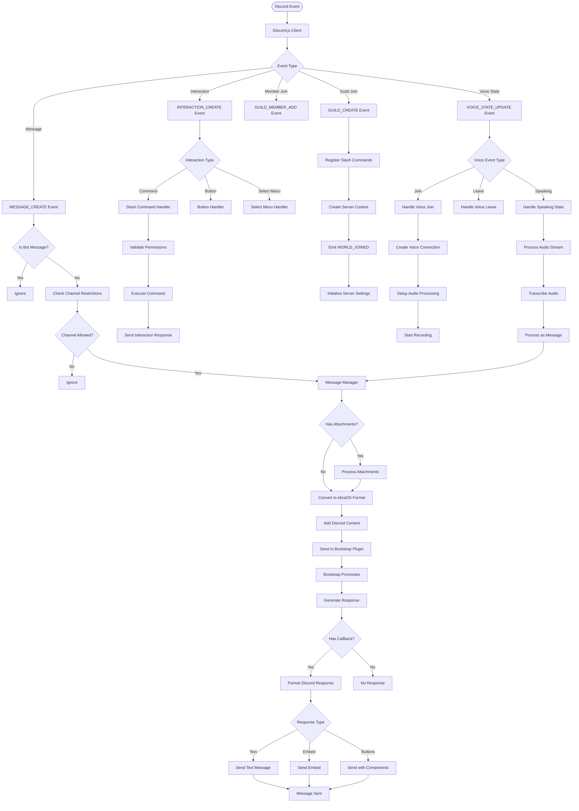
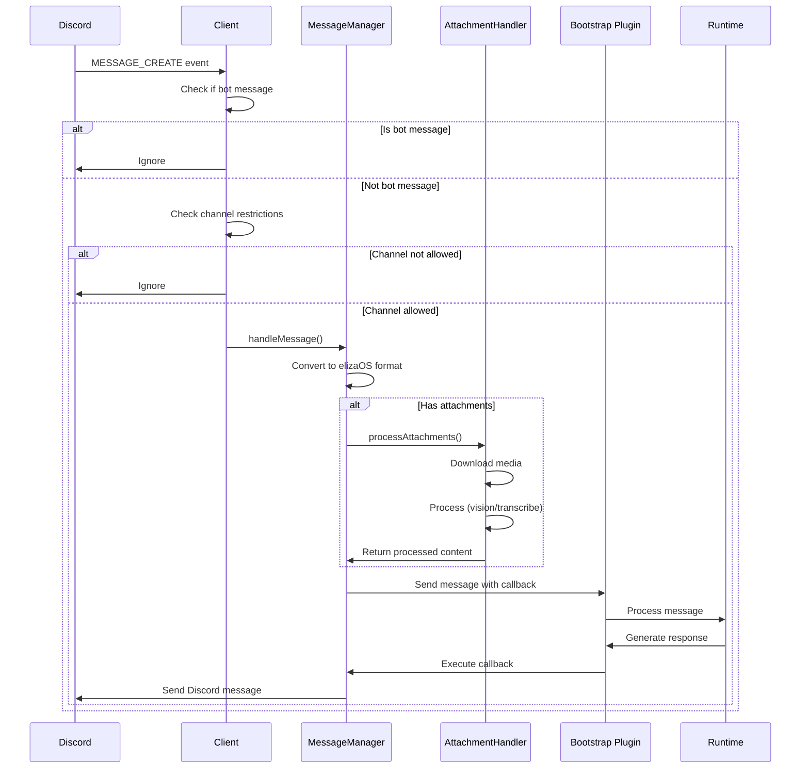

# a7046c18:packages_docs_plugin-registry_platform_discord_event-flow.mdx:1-150

**Commit:** a7046c1843f76b29f0432654f631f950f18a4390
**Author:** lalalune
**Date:** Thu Jan 8 23:05:40 2026 -0800
**File:** packages/docs/plugin-registry/platform/discord/event-flow.mdx:1-150
**Novelty Score:** 23659.22
**Concepts:** agent-system, authentication, blockchain, cache, containerization, documentation, embedded-db, event-driven, llm-integration, orchestration, performance, plugin-system, postgres, prompt-engineering, rag-system, rust-async, security, testing

```
---
title: "Event Flow"
description: "This document provides a comprehensive breakdown of how events flow through the Discord plugin system."
---

This document provides a comprehensive breakdown of how events flow through the Discord plugin system.

## Complete Event Flow Diagram



## Detailed Event Flows

### 1. Message Processing Flow



### 2. Voice Channel Flow

```mermaid
sequenceDiagram
    participant U as User
    participant D as Discord
    participant C as Client
    participant VM as VoiceManager
    participant VC as VoiceConnection
    participant T as Transcription
    
    U->>D: Join voice channel
    D->>C: VOICE_STATE_UPDATE
    C->>VM: handleVoiceStateUpdate()
    VM->>VC: Create connection
    VC->>D: Connect to channel
    
    loop While in channel
        U->>D: Speak
        D->>VC: Audio stream
        VC->>VM: Process audio
        VM->>T: Transcribe audio
        T->>VM: Return text
        VM->>C: Create message from transcript
```