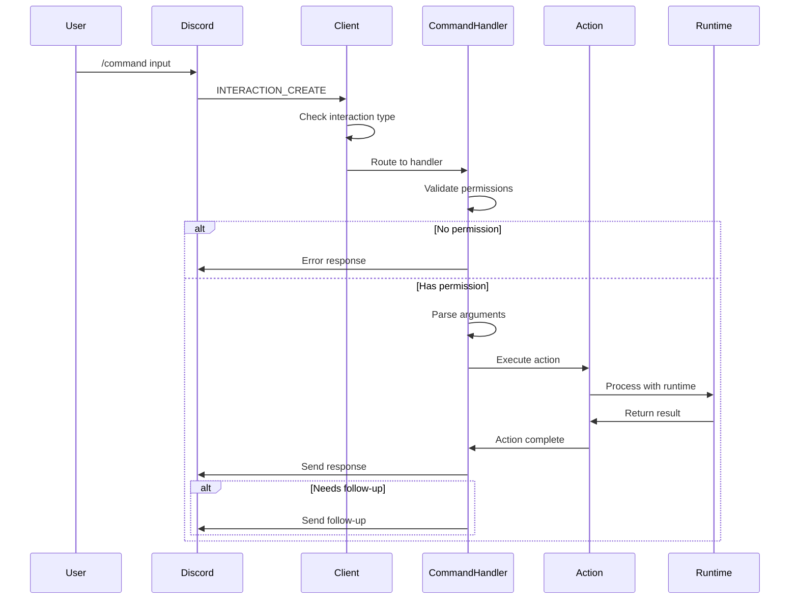
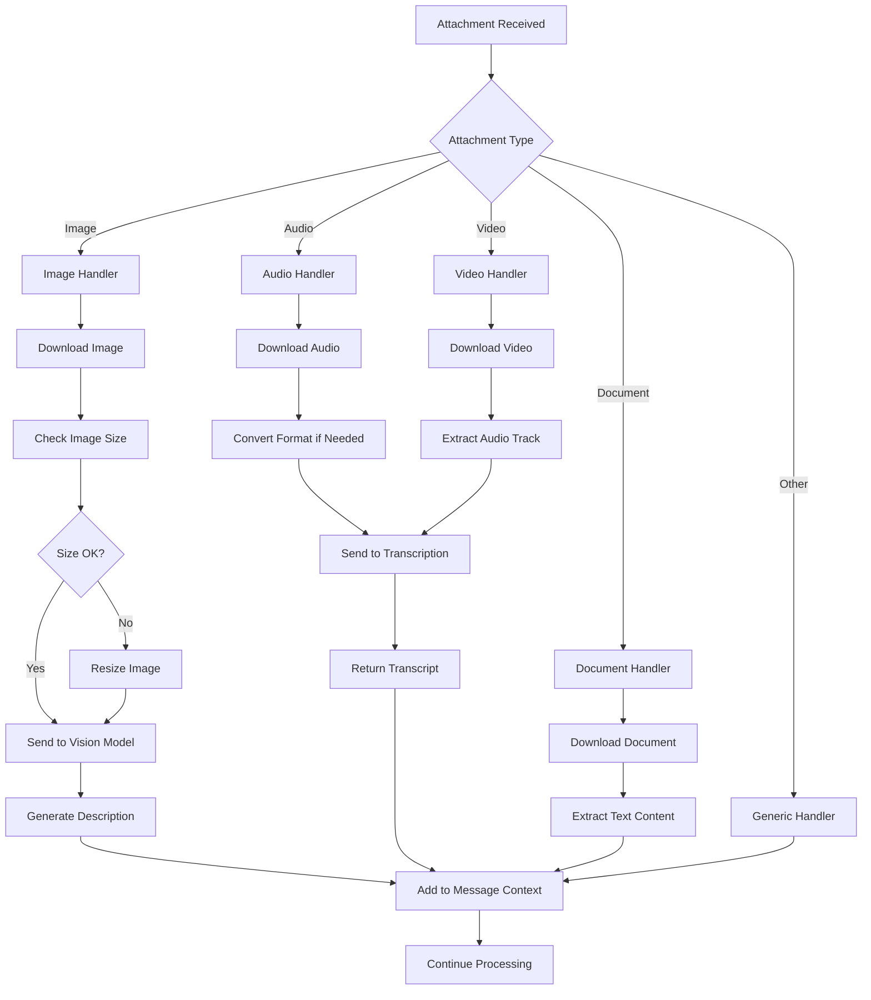
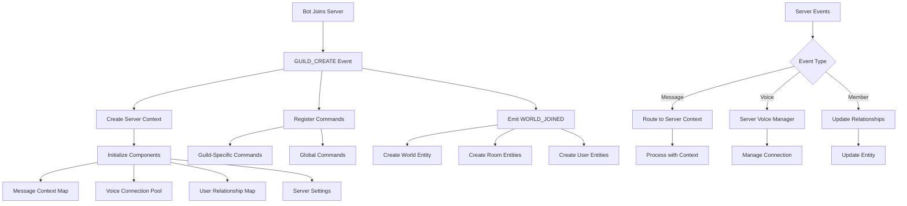

# a7046c18:packages_docs_plugin-registry_platform_discord_event-flow.mdx:151-300

**Commit:** a7046c1843f76b29f0432654f631f950f18a4390
**Author:** lalalune
**Date:** Thu Jan 8 23:05:40 2026 -0800
**File:** packages/docs/plugin-registry/platform/discord/event-flow.mdx:151-300
**Novelty Score:** 23659.22
**Concepts:** agent-system, authentication, blockchain, cache, containerization, documentation, embedded-db, event-driven, llm-integration, orchestration, performance, plugin-system, postgres, prompt-engineering, rag-system, rust-async, security, testing

```
        C->>C: Process as text message
    end
    
    U->>D: Leave channel
    D->>C: VOICE_STATE_UPDATE
    C->>VM: handleVoiceStateUpdate()
    VM->>VC: Disconnect
    VM->>VM: Cleanup resources
```

### 3. Slash Command Flow



### 4. Attachment Processing Flow



### 5. Multi-Server Event Flow



## Event Type Reference

### Discord.js Events

| Event | Description | Plugin Handler |
|-------|-------------|----------------|
| `ready` | Client is ready | Initialize services |
| `messageCreate` | New message | MessageManager |
| `messageUpdate` | Message edited | MessageManager |
| `messageDelete` | Message deleted | Cleanup handler |
| `interactionCreate` | Slash command/button | Interaction router |
| `guildCreate` | Bot joins server | Server initializer |
| `guildDelete` | Bot leaves server | Cleanup handler |
| `guildMemberAdd` | Member joins | Relationship manager |
| `voiceStateUpdate` | Voice state change | VoiceManager |
| `error` | Client error | Error handler |
| `disconnect` | Lost connection | Reconnection handler |

### elizaOS Events Emitted

| Event | When Emitted | Payload |
|-------|--------------|---------|
| `WORLD_JOINED` | Bot joins server | World, rooms, entities |
| `MESSAGE_RECEIVED` | Message processed | elizaOS message format |
| `VOICE_MESSAGE_RECEIVED` | Voice transcribed | Transcribed message |
| `REACTION_RECEIVED` | Reaction added | Reaction details |
| `INTERACTION_RECEIVED` | Slash command used | Interaction data |

## State Management

### Message Context

```typescript
interface MessageContext {
  channelId: string;
```