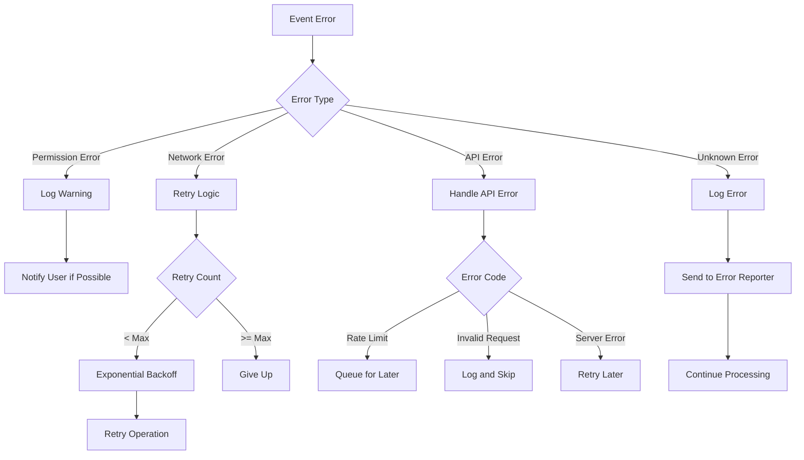

# a7046c18:packages_docs_plugin-registry_platform_discord_event-flow.mdx:301-450

**Commit:** a7046c1843f76b29f0432654f631f950f18a4390
**Author:** lalalune
**Date:** Thu Jan 8 23:05:40 2026 -0800
**File:** packages/docs/plugin-registry/platform/discord/event-flow.mdx:301-450
**Novelty Score:** 23659.22
**Concepts:** agent-system, authentication, blockchain, cache, containerization, documentation, embedded-db, event-driven, llm-integration, orchestration, performance, plugin-system, postgres, prompt-engineering, rag-system, rust-async, security, testing

```
  serverId: string;
  userId: string;
  threadId?: string;
  referencedMessageId?: string;
  attachments: ProcessedAttachment[];
  discordMetadata: {
    messageId: string;
    timestamp: number;
    editedTimestamp?: number;
    isPinned: boolean;
    mentions: string[];
  };
}
```

### Voice Context

```typescript
interface VoiceContext {
  channelId: string;
  serverId: string;
  connection: VoiceConnection;
  activeUsers: Map<string, VoiceUserState>;
  recordingState: {
    isRecording: boolean;
    startTime?: number;
    audioBuffer: Buffer[];
  };
}
```

## Error Handling in Event Flow

### Error Propagation



## Performance Considerations

### Event Batching

For high-volume servers, events are batched:

```typescript
class EventBatcher {
  private messageQueue: DiscordMessage[] = [];
  private batchTimer?: NodeJS.Timeout;
  
  addMessage(message: DiscordMessage) {
    this.messageQueue.push(message);
    
    if (!this.batchTimer) {
      this.batchTimer = setTimeout(() => {
        this.processBatch();
      }, 100); // 100ms batch window
    }
  }
  
  private async processBatch() {
    const batch = [...this.messageQueue];
    this.messageQueue = [];
    this.batchTimer = undefined;
    
    // Process messages in parallel
    await Promise.all(
      batch.map(msg => this.processMessage(msg))
    );
  }
}
```

### Connection Pooling

Voice connections are pooled to reduce overhead:

```typescript
class VoiceConnectionPool {
  private connections = new Map<string, VoiceConnection>();
  private maxConnections = 10;
  
  async getConnection(channelId: string): Promise<VoiceConnection> {
    // Reuse existing connection
    const existing = this.connections.get(channelId);
    if (existing?.state.status === VoiceConnectionStatus.Ready) {
      return existing;
    }
    
    // Check pool limit
    if (this.connections.size >= this.maxConnections) {
      await this.evictOldestConnection();
    }
    
    // Create new connection
    const connection = await this.createConnection(channelId);
    this.connections.set(channelId, connection);
    return connection;
  }
}
```

## Monitoring Event Flow

### Event Metrics

Track event processing metrics:

```typescript
interface EventMetrics {
  eventType: string;
  processingTime: number;
  success: boolean;
  errorType?: string;
  serverId: string;
  channelId: string;
}

class EventMonitor {
  private metrics: EventMetrics[] = [];
  
  recordEvent(metric: EventMetrics) {
    this.metrics.push(metric);
    
    // Log slow events
    if (metric.processingTime > 1000) {
      logger.warn(`Slow event processing: ${metric.eventType} took ${metric.processingTime}ms`);
    }
  }
  
```