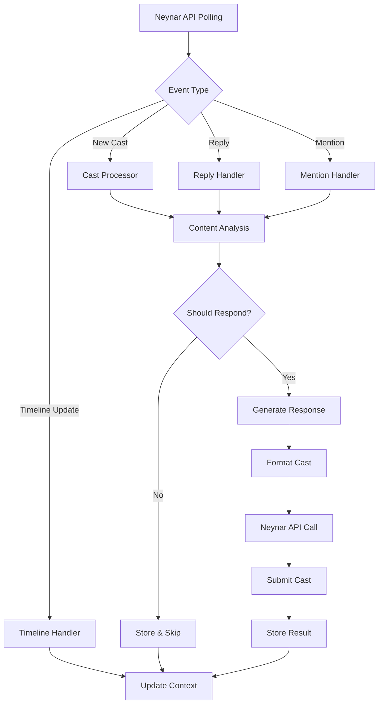
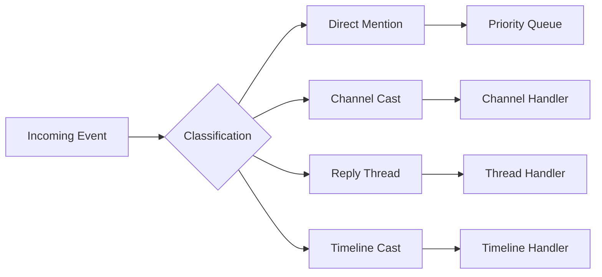
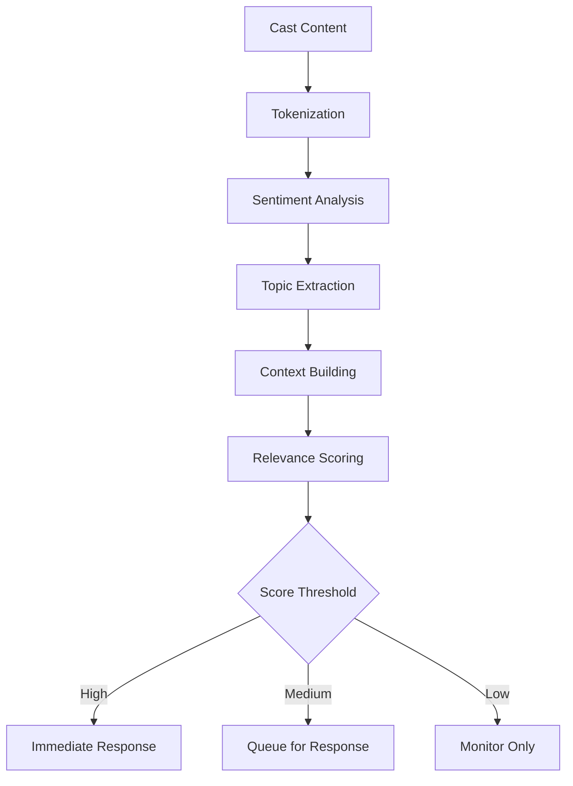
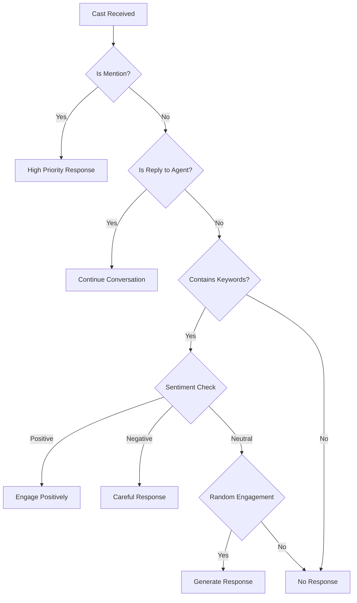
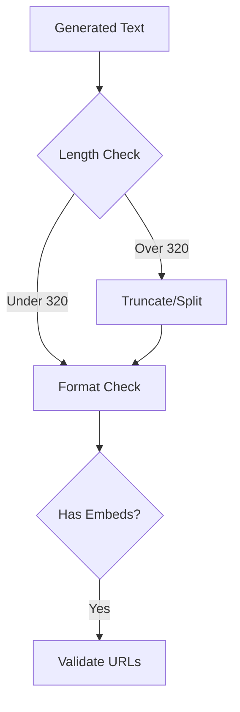

# a7046c18:packages_docs_plugin-registry_platform_farcaster_cast-flow.mdx:1-150

**Commit:** a7046c1843f76b29f0432654f631f950f18a4390
**Author:** lalalune
**Date:** Thu Jan 8 23:05:40 2026 -0800
**File:** packages/docs/plugin-registry/platform/farcaster/cast-flow.mdx:1-150
**Novelty Score:** 23659.22
**Concepts:** agent-system, authentication, blockchain, cache, containerization, documentation, embedded-db, event-driven, llm-integration, orchestration, performance, plugin-system, postgres, prompt-engineering, rag-system, rust-async, security, testing

```
---
title: "Cast Flow"
description: "Visual guide to understanding how the Farcaster plugin processes casts and interactions"
---

# Farcaster Cast Flow

## Overview

This document provides a visual and detailed explanation of how the Farcaster plugin processes casts, from initial receipt through evaluation, response generation, and posting.

## Cast Processing Pipeline



## Detailed Flow Stages

### 1. Event Reception

The plugin polls the Neynar API for relevant events and interactions:

```typescript
// Neynar API polling for mentions and timeline
setInterval(async () => {
  const mentions = await neynarClient.fetchMentions({
    fid: agentFid,
    limit: 10
  });
  
  const timeline = await neynarClient.fetchTimeline({
    fid: agentFid,
    type: 'ForYou'
  });
  
  await processEvents(mentions, timeline);
}, FARCASTER_POLL_INTERVAL * 60000);
```

### 2. Event Classification

Events are classified and routed to appropriate handlers:



### 3. Content Analysis

Each cast undergoes multi-stage analysis:



### 4. Response Decision Tree



### 5. Response Generation

The response generation process:

```typescript
async function generateResponse(context: CastContext): Promise<string> {
  // 1. Build conversation history
  const thread = await getThreadContext(context.parentHash);
  
  // 2. Extract key topics
  const topics = extractTopics(context.text);
  
  // 3. Generate appropriate response
  const response = await llm.generate({
    system: character.personality,
    context: thread,
    topics: topics,
    maxLength: 320
  });
  
  // 4. Validate and format
  return formatCast(response);
}
```

### 6. Cast Composition

