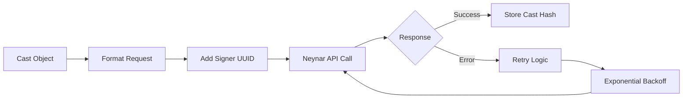
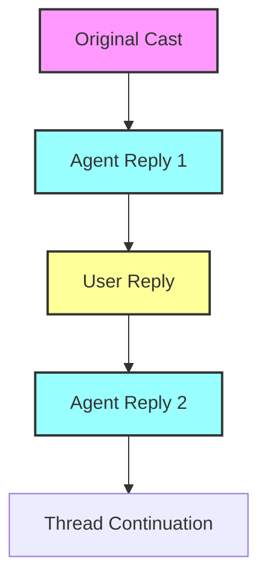
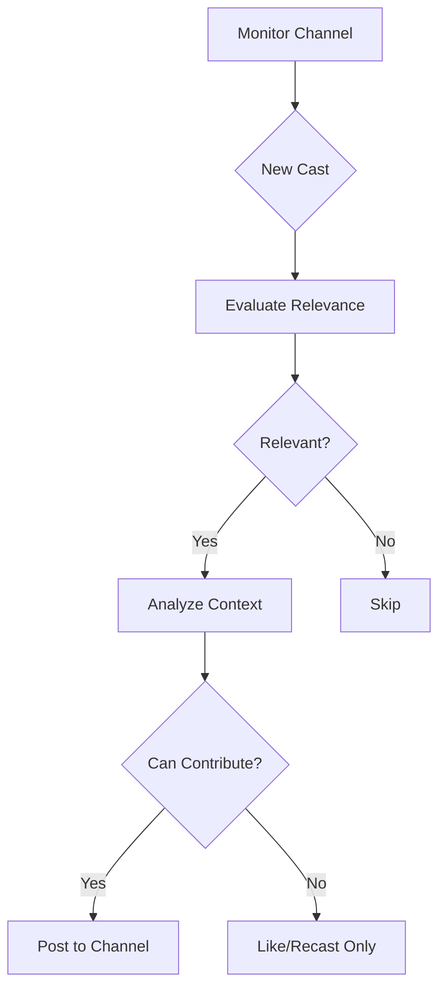
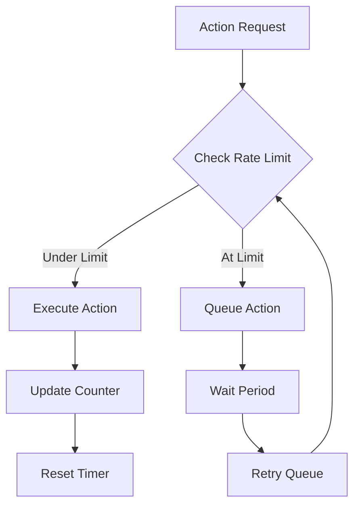
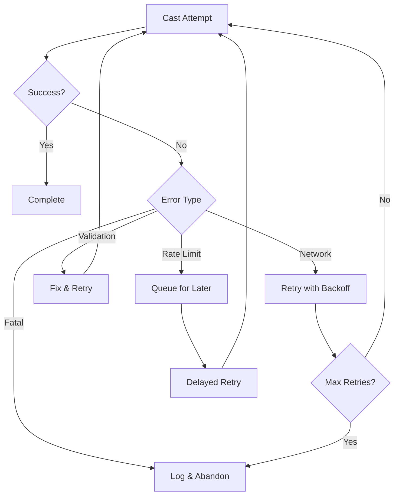
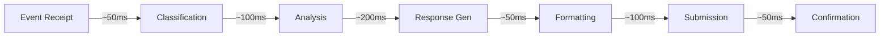
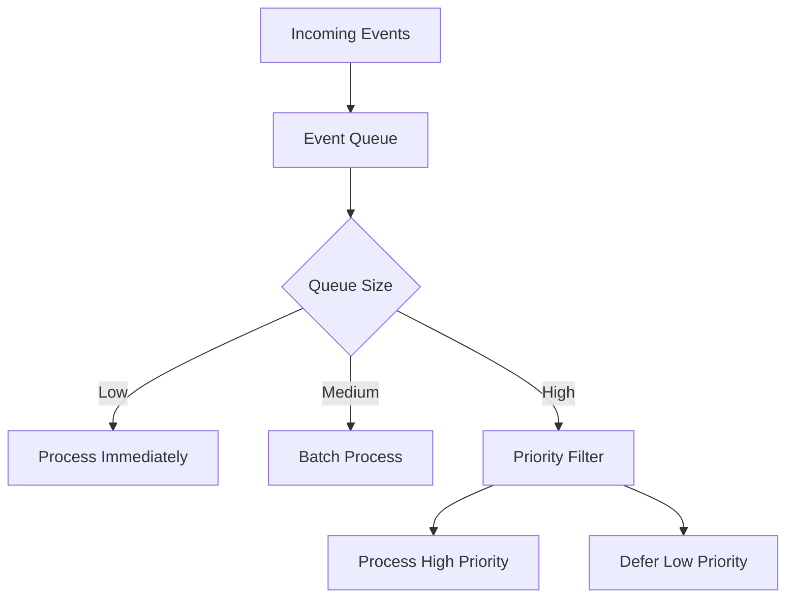
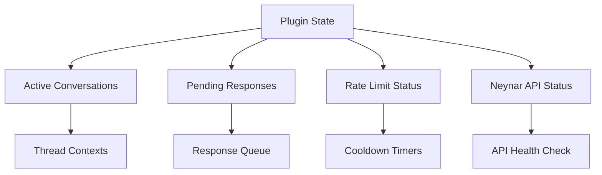
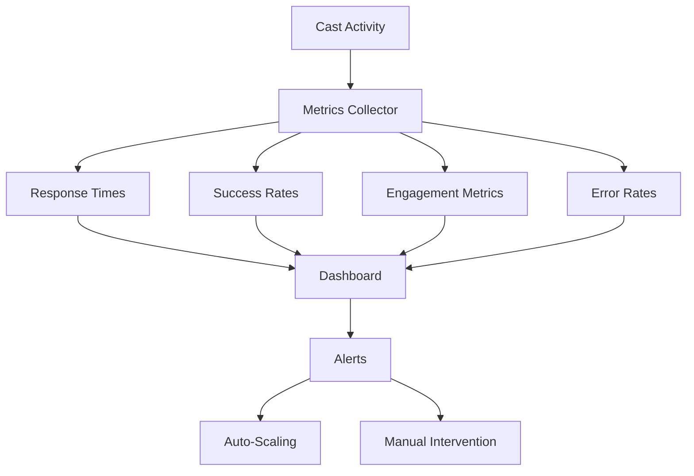

# a7046c18:packages_docs_plugin-registry_platform_farcaster_cast-flow.mdx:151-300

**Commit:** a7046c1843f76b29f0432654f631f950f18a4390
**Author:** lalalune
**Date:** Thu Jan 8 23:05:40 2026 -0800
**File:** packages/docs/plugin-registry/platform/farcaster/cast-flow.mdx:151-300
**Novelty Score:** 23659.22
**Concepts:** agent-system, authentication, blockchain, cache, containerization, documentation, embedded-db, event-driven, llm-integration, orchestration, performance, plugin-system, postgres, prompt-engineering, rag-system, rust-async, security, testing

```
    E -->|No| G[Add Metadata]
    F --> G
    G --> H{Channel Cast?}
    H -->|Yes| I[Add Channel Tag]
    H -->|No| J[Standard Cast]
    I --> K[Final Cast Object]
    J --> K
```

### 7. Cast Publishing via Neynar



## Interaction Patterns

### Reply Chains



### Channel Participation



## Rate Limiting & Throttling



## Error Handling Flow



## Performance Metrics

### Processing Times



### Throughput Management



## State Management



## Monitoring & Observability



```