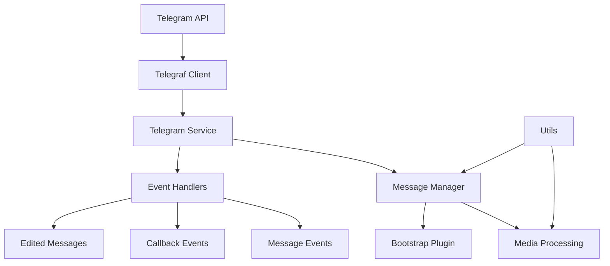

# a7046c18:packages_docs_plugin-registry_platform_telegram_developer-guide.mdx:1-150

**Commit:** a7046c1843f76b29f0432654f631f950f18a4390
**Author:** lalalune
**Date:** Thu Jan 8 23:05:40 2026 -0800
**File:** packages/docs/plugin-registry/platform/telegram/developer-guide.mdx:1-150
**Novelty Score:** 23659.22
**Concepts:** agent-system, authentication, blockchain, cache, containerization, documentation, embedded-db, event-driven, llm-integration, orchestration, performance, plugin-system, postgres, prompt-engineering, rag-system, rust-async, security, testing

```
---
title: "Developer Guide"
description: "Comprehensive Telegram Bot API integration for elizaOS agents. It enables agents to operate as Telegram bots with advanced features and capabilities."
---

## Overview

The `@elizaos/plugin-telegram` package provides comprehensive Telegram Bot API integration for elizaOS agents. It enables agents to operate as Telegram bots with support for private chats, groups, channels, media processing, interactive buttons, and forum topics.

This plugin handles all Telegram-specific functionality including:
- Initializing and managing the Telegram bot connection via Telegraf
- Processing messages across different chat types
- Handling media attachments and documents
- Managing interactive UI elements (buttons, keyboards)
- Supporting forum topics as separate conversation contexts
- Implementing access control and chat restrictions

## Architecture Overview



## Core Components

### Telegram Service

The `TelegramService` class is the main entry point for Telegram functionality:

```typescript
export class TelegramService extends Service {
  static serviceType = TELEGRAM_SERVICE_NAME;
  private bot: Telegraf<Context> | null;
  public messageManager: MessageManager | null;
  private knownChats: Map<string, any> = new Map();
  private syncedEntityIds: Set<string> = new Set<string>();
  
  constructor(runtime: IAgentRuntime) {
    super(runtime);
    // Initialize bot with token
    // Set up middleware
    // Configure event handlers
  }
}
```

#### Key Responsibilities:

1. **Bot Initialization**
   - Creates Telegraf instance with bot token
   - Configures API root if custom endpoint provided
   - Handles connection lifecycle

2. **Middleware Setup**
   - Preprocesses incoming updates
   - Manages chat synchronization
   - Handles user entity creation

3. **Event Registration**
   - Message handlers
   - Callback query handlers
   - Edited message handlers

4. **Chat Management**
   - Tracks known chats
   - Syncs chat metadata
   - Manages access control

### Message Manager

The `MessageManager` class handles all message-related operations:

```typescript
export class MessageManager {
  private bot: Telegraf<Context>;
  private runtime: IAgentRuntime;
  private messageHistory: Map<string, Array<TelegramMessage>>;
  private messageCallbacks: Map<string, (response: Content) => void>;
  
  async handleMessage(ctx: Context): Promise<void> {
    // Convert Telegram message to elizaOS format
    // Process media if present
    // Send to bootstrap plugin
    // Handle response
  }
  
  async sendMessageToTelegram(
    chatId: number | string,
    content: Content,
    replyToMessageId?: number
  ): Promise<void> {
    // Format content for Telegram
    // Handle buttons/keyboards
    // Send via bot API
  }
}
```

#### Message Processing Flow:

1. **Message Reception**
   ```typescript
   // Telegram message received
   const message = ctx.message;
   if (!this.shouldProcessMessage(ctx)) return;
   ```

2. **Format Conversion**
   ```typescript
   const elizaMessage: ElizaMessage = {
     content: {
       text: message.text || message.caption || '',
       attachments: await this.processAttachments(message)
     },
     userId: createUniqueUuid(ctx.from.id.toString()),
     channelId: ctx.chat.id.toString(),
     roomId: this.getRoomId(ctx)
   };
   ```

3. **Media Processing**
   ```typescript
   if (message.photo || message.document || message.voice) {
     elizaMessage.content.attachments = await processMediaAttachments(
       ctx,
       this.bot,
       this.runtime
     );
   }
   ```

4. **Response Handling**
   ```typescript
   const callback = async (response: Content) => {
     await this.sendMessageToTelegram(
       ctx.chat.id,
```