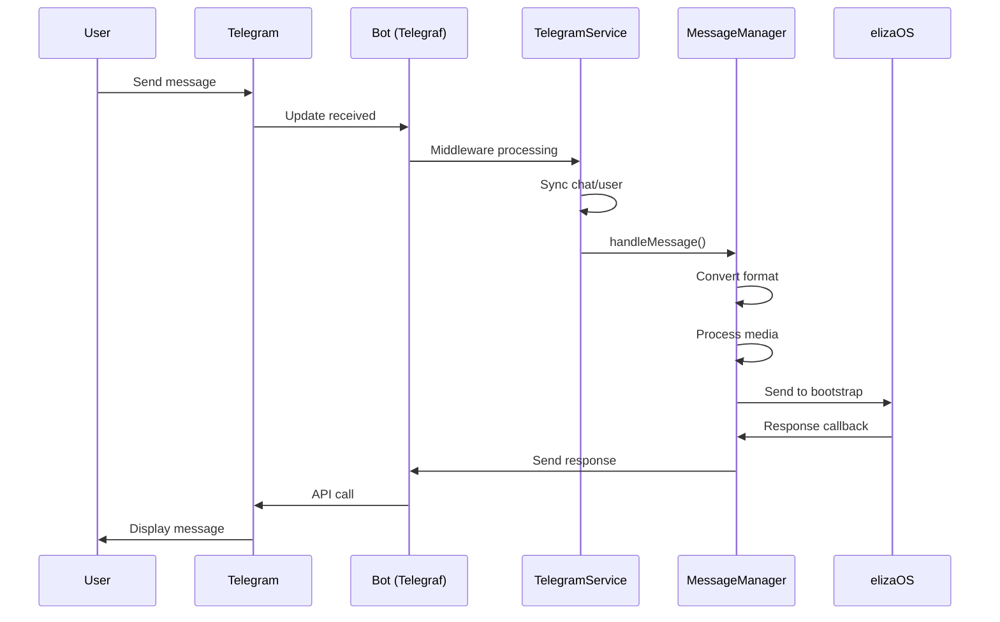
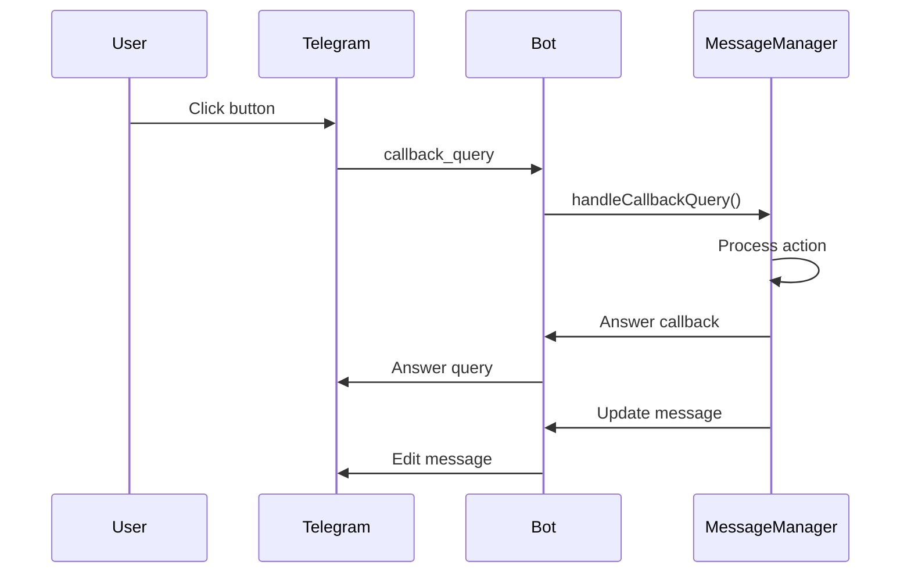

# a7046c18:packages_docs_plugin-registry_platform_telegram_developer-guide.mdx:151-300

**Commit:** a7046c1843f76b29f0432654f631f950f18a4390
**Author:** lalalune
**Date:** Thu Jan 8 23:05:40 2026 -0800
**File:** packages/docs/plugin-registry/platform/telegram/developer-guide.mdx:151-300
**Novelty Score:** 23659.22
**Concepts:** agent-system, authentication, blockchain, cache, containerization, documentation, embedded-db, event-driven, llm-integration, orchestration, performance, plugin-system, postgres, prompt-engineering, rag-system, rust-async, security, testing

```
       response,
       message.message_id
     );
   };
   ```

### Utilities

Various utility functions support the core functionality:

```typescript
// Media processing
export async function processMediaAttachments(
  ctx: Context,
  bot: Telegraf,
  runtime: IAgentRuntime
): Promise<Attachment[]> {
  const attachments: Attachment[] = [];
  
  if (ctx.message?.photo) {
    // Process photo
    const photo = ctx.message.photo[ctx.message.photo.length - 1];
    const file = await bot.telegram.getFile(photo.file_id);
    // Download and process...
  }
  
  if (ctx.message?.voice) {
    // Process voice message
    const voice = ctx.message.voice;
    const file = await bot.telegram.getFile(voice.file_id);
    // Transcribe audio...
  }
  
  return attachments;
}

// Button creation
export function createInlineKeyboard(buttons: Button[]): InlineKeyboardMarkup {
  const keyboard = buttons.map(button => [{
    text: button.text,
    ...(button.url ? { url: button.url } : { callback_data: button.callback_data })
  }]);
  
  return { inline_keyboard: keyboard };
}
```

## Event Processing Flow

### Message Flow



### Callback Query Flow



## Configuration

### Environment Variables

```bash
# Required
TELEGRAM_BOT_TOKEN=123456:ABC-DEF1234ghIkl-zyx57W2v1u123ew11

# Optional
TELEGRAM_API_ROOT=https://api.telegram.org  # Custom API endpoint
TELEGRAM_ALLOWED_CHATS=["123456789", "-987654321"]  # JSON array of chat IDs

# Testing
TELEGRAM_TEST_CHAT_ID=-1001234567890  # Test chat for integration tests
```

### Character Configuration

```typescript
const character = {
  name: "TelegramBot",
  clients: ["telegram"],
  settings: {
    // Bot behavior
    allowDirectMessages: true,
    shouldOnlyJoinInAllowedGroups: false,
    allowedGroupIds: ["-123456789", "-987654321"],
    messageTrackingLimit: 100,
    
    // Templates
    templates: {
      telegramMessageHandlerTemplate: "Custom message template",
      telegramShouldRespondTemplate: "Custom decision template"
    }
  }
};
```

### Bot Creation

1. **Create Bot with BotFather**
   ```
   1. Open @BotFather in Telegram
   2. Send /newbot
   3. Choose a name for your bot
   4. Choose a username (must end in 'bot')
   5. Save the token provided
   ```

2. **Configure Bot Settings**
   ```
   /setprivacy - Disable for group message access
   /setcommands - Set bot commands
   /setdescription - Add bot description
   /setabouttext - Set about text
   ```

```