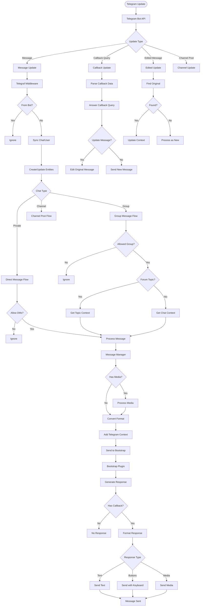
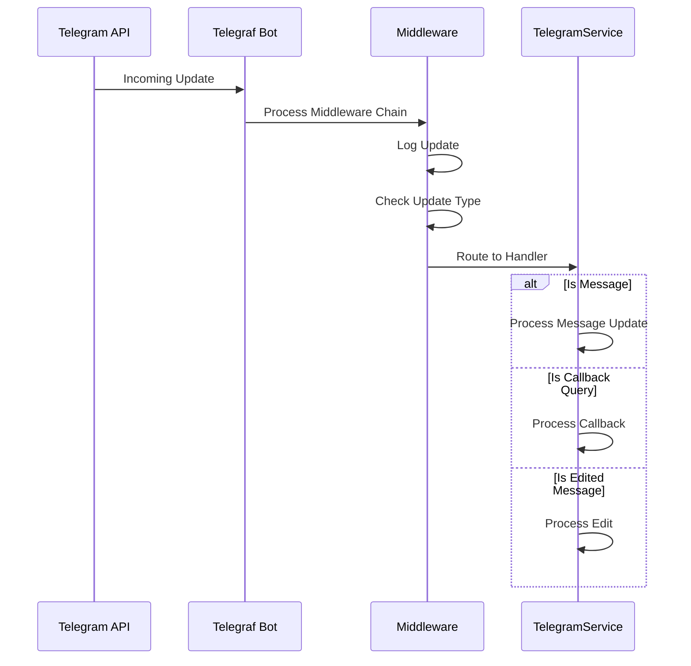
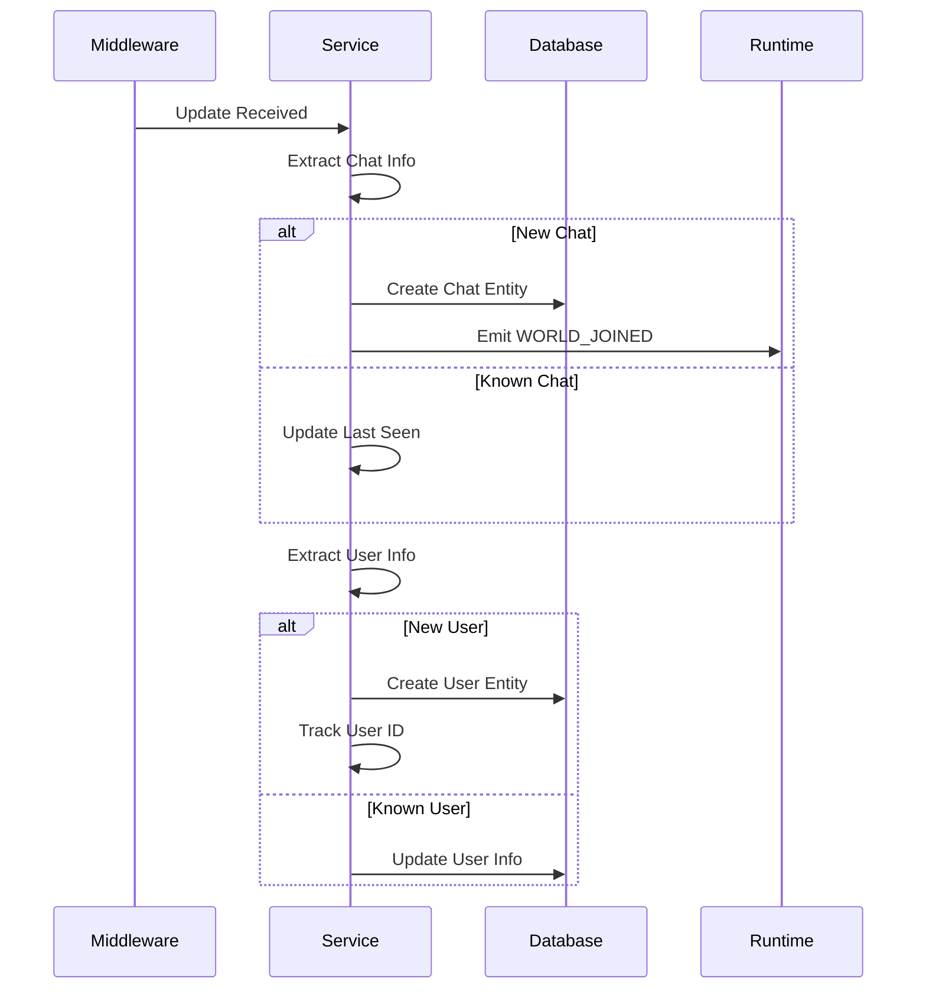
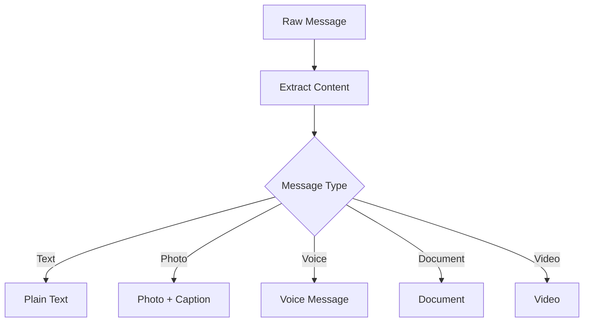

# a7046c18:packages_docs_plugin-registry_platform_telegram_message-flow.mdx:1-150

**Commit:** a7046c1843f76b29f0432654f631f950f18a4390
**Author:** lalalune
**Date:** Thu Jan 8 23:05:40 2026 -0800
**File:** packages/docs/plugin-registry/platform/telegram/message-flow.mdx:1-150
**Novelty Score:** 23659.22
**Concepts:** agent-system, authentication, blockchain, cache, containerization, documentation, embedded-db, event-driven, llm-integration, orchestration, performance, plugin-system, postgres, prompt-engineering, rag-system, rust-async, security, testing

```
---
title: "Message Flow"
description: "This document provides a comprehensive breakdown of how messages flow through the Telegram plugin system."
---

# Telegram Plugin Message Flow - Detailed Breakdown

This document provides a comprehensive breakdown of how messages flow through the Telegram plugin system.

## Complete Message Flow Diagram



## Detailed Event Flows

### 1. Initial Update Processing



### 2. Chat/User Synchronization



### 3. Message Processing Pipeline

