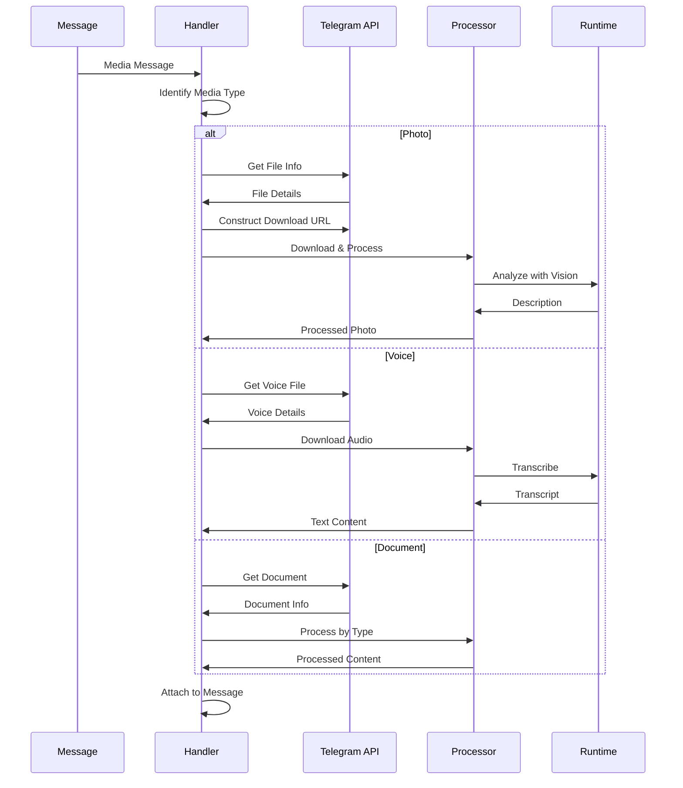
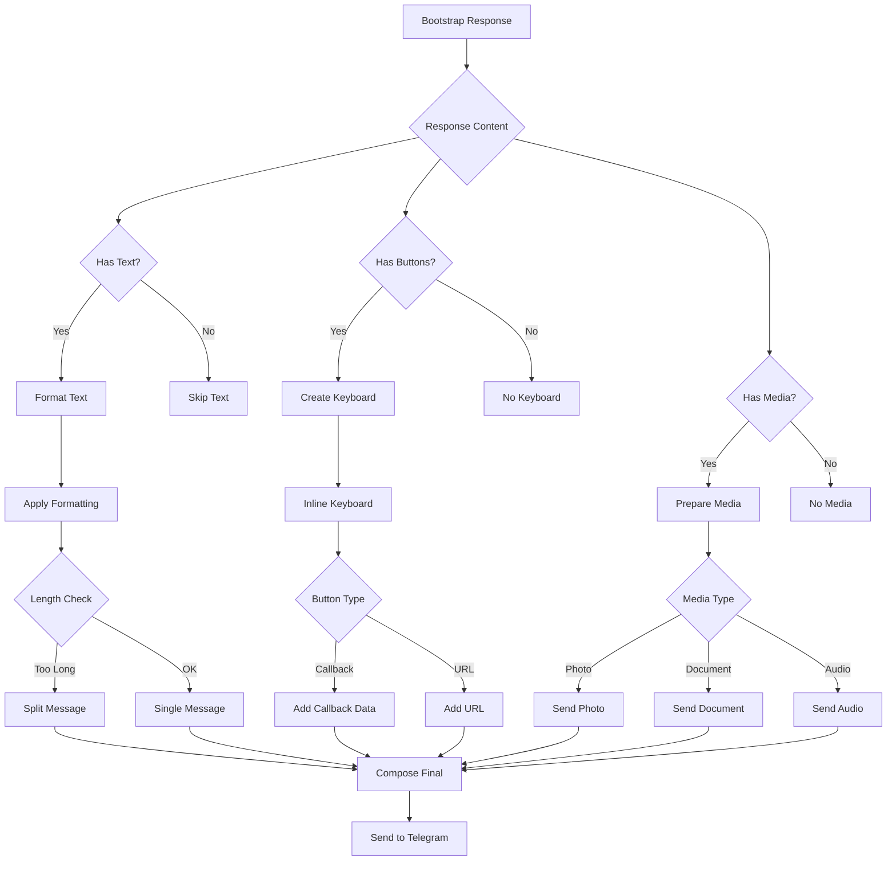
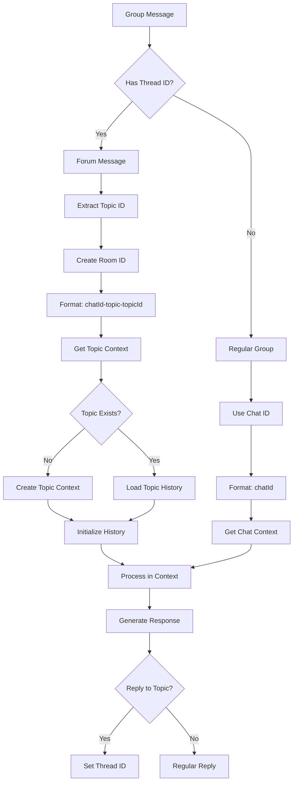

# a7046c18:packages_docs_plugin-registry_platform_telegram_message-flow.mdx:151-300

**Commit:** a7046c1843f76b29f0432654f631f950f18a4390
**Author:** lalalune
**Date:** Thu Jan 8 23:05:40 2026 -0800
**File:** packages/docs/plugin-registry/platform/telegram/message-flow.mdx:151-300
**Novelty Score:** 23659.22
**Concepts:** agent-system, authentication, blockchain, cache, containerization, documentation, embedded-db, event-driven, llm-integration, orchestration, performance, plugin-system, postgres, prompt-engineering, rag-system, rust-async, security, testing

```
    
    E --> I[Download Photo]
    I --> J[Get File URL]
    J --> K[Analyze Image]
    K --> L[Add Description]
    
    F --> M[Download Voice]
    M --> N[Transcribe Audio]
    N --> O[Add Transcript]
    
    G --> P[Check MIME Type]
    P --> Q{Document Type}
    Q -->|Image| K
    Q -->|Text| R[Extract Text]
    Q -->|Other| S[Store Reference]
    
    D --> T[Create Message Object]
    L --> T
    O --> T
    R --> T
    S --> T
    
    T --> U[Add Metadata]
    U --> V[Message Ready]
```

### 4. Media Processing Flow



### 5. Response Generation Flow



### 6. Forum Topic Handling



## State Management

### Message State

```typescript
interface TelegramMessageState {
  // Core message data
```