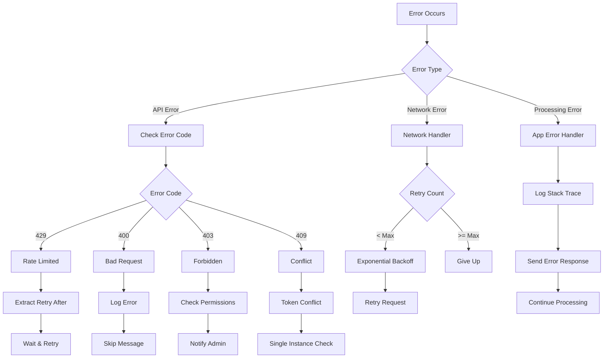
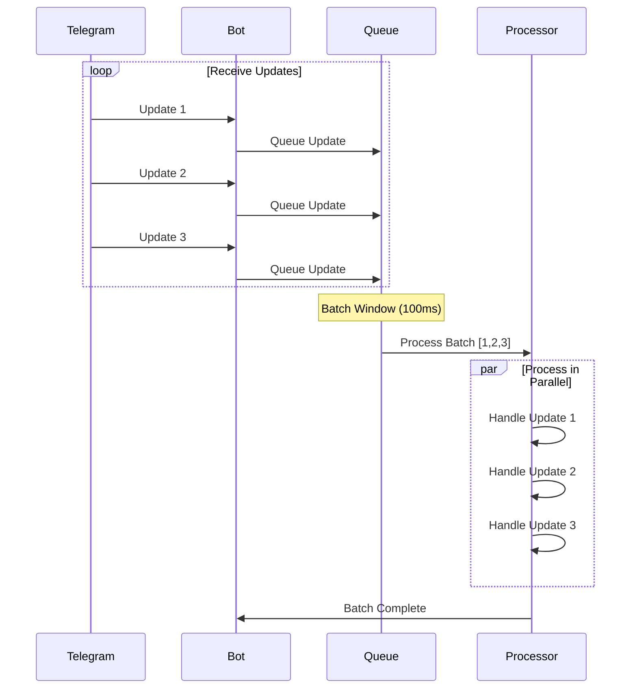
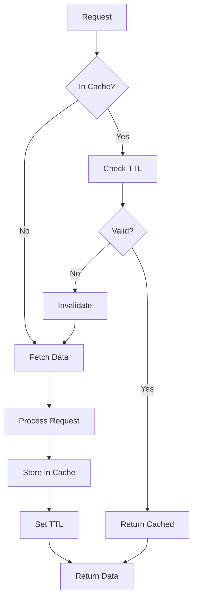

# a7046c18:packages_docs_plugin-registry_platform_telegram_message-flow.mdx:301-450

**Commit:** a7046c1843f76b29f0432654f631f950f18a4390
**Author:** lalalune
**Date:** Thu Jan 8 23:05:40 2026 -0800
**File:** packages/docs/plugin-registry/platform/telegram/message-flow.mdx:301-450
**Novelty Score:** 23659.22
**Concepts:** agent-system, authentication, blockchain, cache, containerization, documentation, embedded-db, event-driven, llm-integration, orchestration, performance, plugin-system, postgres, prompt-engineering, rag-system, rust-async, security, testing

```
  messageId: number;
  chatId: string;
  userId: string;
  timestamp: Date;
  
  // Content
  text?: string;
  media?: MediaAttachment[];
  
  // Context
  replyToMessageId?: number;
  threadId?: number;
  editedAt?: Date;
  
  // Metadata
  entities?: MessageEntity[];
  buttons?: InlineKeyboardButton[][];
}
```

### Chat State

```typescript
interface TelegramChatState {
  chatId: string;
  chatType: 'private' | 'group' | 'supergroup' | 'channel';
  title?: string;
  username?: string;
  
  // Settings
  allowedUsers?: string[];
  messageLimit: number;
  
  // Forum support
  isForumChat: boolean;
  topics: Map<number, TopicState>;
  
  // History
  messages: TelegramMessage[];
  lastActivity: Date;
}
```

### Callback State

```typescript
interface CallbackState {
  messageId: number;
  chatId: string;
  callbackData: string;
  userId: string;
  timestamp: Date;
  
  // For maintaining state
  originalMessage?: TelegramMessage;
  context?: any;
}
```

## Error Handling Flow



## Performance Optimization

### Message Batching



### Caching Strategy

