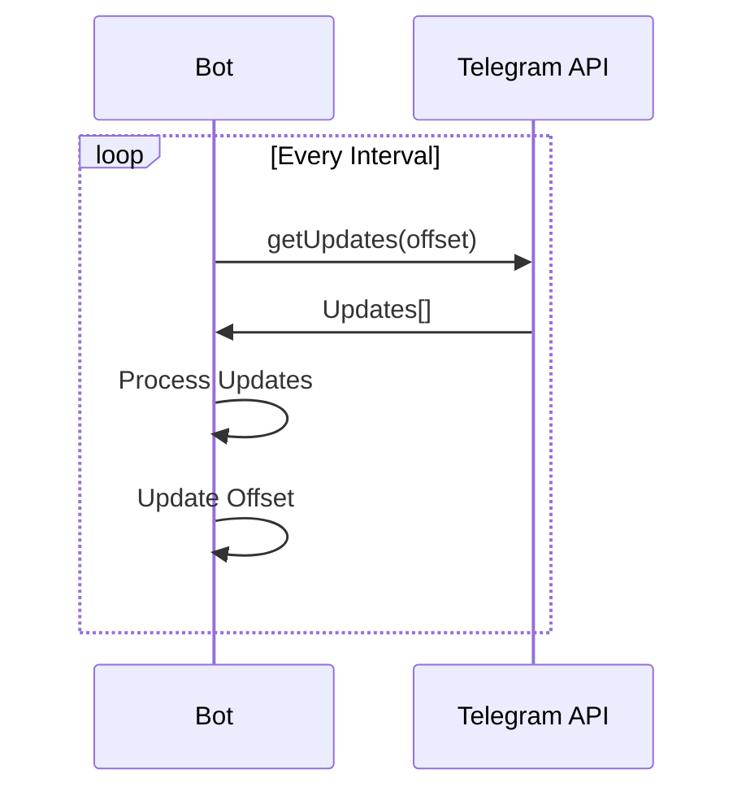
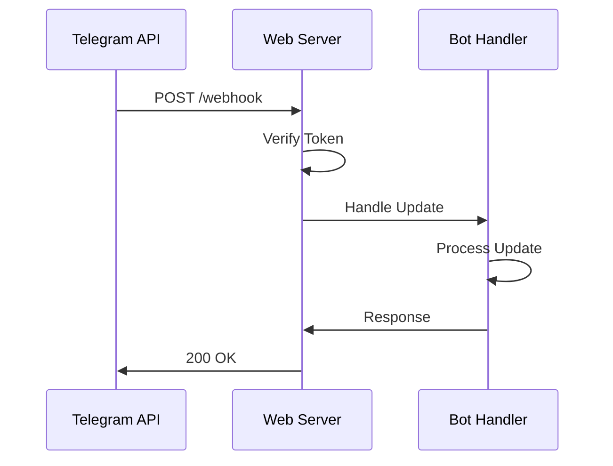
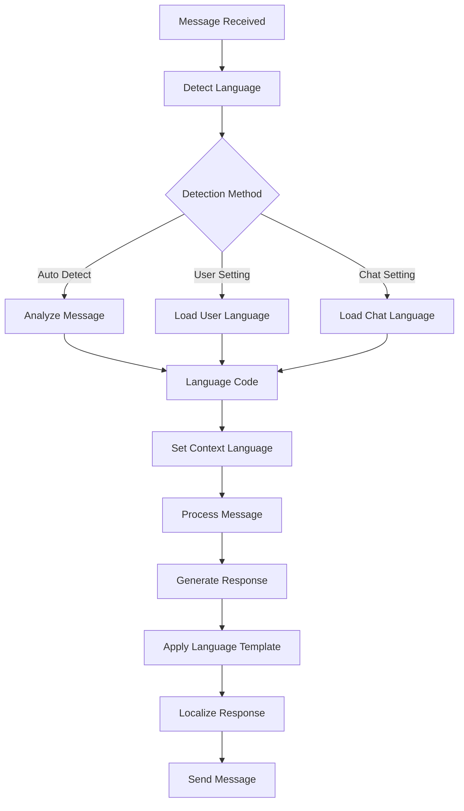
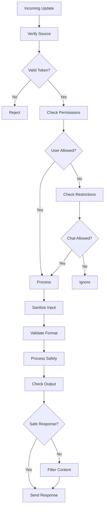

# a7046c18:packages_docs_plugin-registry_platform_telegram_message-flow.mdx:451-569

**Commit:** a7046c1843f76b29f0432654f631f950f18a4390
**Author:** lalalune
**Date:** Thu Jan 8 23:05:40 2026 -0800
**File:** packages/docs/plugin-registry/platform/telegram/message-flow.mdx:451-569
**Novelty Score:** 23659.22
**Concepts:** agent-system, authentication, blockchain, cache, containerization, documentation, embedded-db, event-driven, llm-integration, orchestration, performance, plugin-system, postgres, prompt-engineering, rag-system, rust-async, security, testing

```
    
    L[Cache Types] --> M[User Cache]
    L --> N[Chat Cache]
    L --> O[Media Cache]
    L --> P[Response Cache]
```

## Webhook vs Polling

### Polling Flow



### Webhook Flow



## Multi-Language Support



## Security Flow



## Best Practices

1. **Update Handling**
   - Process updates asynchronously
   - Implement proper error boundaries
   - Log all update types

2. **State Management**
   - Maintain minimal state
   - Use TTL for cached data
   - Clean up old conversations

3. **Performance**
   - Batch similar operations
   - Use webhooks in production
   - Implement connection pooling

4. **Error Recovery**
   - Implement exponential backoff
   - Log errors with context
   - Provide fallback responses

5. **Security**
   - Validate all inputs
   - Sanitize user content
   - Implement rate limiting
```