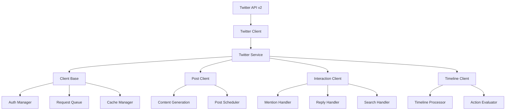

# a7046c18:packages_docs_plugin-registry_platform_twitter_developer-guide.mdx:1-150

**Commit:** a7046c1843f76b29f0432654f631f950f18a4390
**Author:** lalalune
**Date:** Thu Jan 8 23:05:40 2026 -0800
**File:** packages/docs/plugin-registry/platform/twitter/developer-guide.mdx:1-150
**Novelty Score:** 23659.22
**Concepts:** agent-system, authentication, blockchain, cache, containerization, documentation, embedded-db, event-driven, llm-integration, orchestration, performance, plugin-system, postgres, prompt-engineering, rag-system, rust-async, security, testing

```
---
title: "Developer Guide"
description: "Comprehensive Twitter/X API v2 integration for elizaOS agents. It enables agents to operate as fully autonomous Twitter bots with advanced capabilities."
---

## Overview

The `@elizaos/plugin-twitter` package provides comprehensive Twitter/X API v2 integration for elizaOS agents. It enables agents to operate as fully autonomous Twitter bots with capabilities including tweet posting, timeline monitoring, interaction handling, direct messaging, and advanced features like weighted timeline algorithms.

This plugin handles all Twitter-specific functionality including:
- Managing Twitter API authentication and client connections
- Autonomous tweet generation and posting
- Timeline monitoring and interaction processing
- Search functionality and mention tracking
- Direct message handling
- Advanced timeline algorithms with configurable weights
- Rate limiting and request queuing
- Media attachment support

## Architecture Overview



## Core Components

### Twitter Service

The `TwitterService` class manages multiple Twitter client instances:

```typescript
export class TwitterService extends Service {
  static serviceType: string = TWITTER_SERVICE_NAME;
  private static instance: TwitterService;
  private clients: Map<string, TwitterClientInstance> = new Map();
  
  async createClient(
    runtime: IAgentRuntime,
    clientId: string,
    state: any
  ): Promise<TwitterClientInstance> {
    // Create and initialize client
    const client = new TwitterClientInstance(runtime, state);
    await client.client.init();
    
    // Start services based on configuration
    if (client.post) client.post.start();
    if (client.interaction) client.interaction.start();
    if (client.timeline) client.timeline.start();
    
    // Store client
    this.clients.set(clientKey, client);
    
    // Emit WORLD_JOINED event
    await this.emitServerJoinedEvent(runtime, client);
    
    return client;
  }
}
```

### Client Base

The foundation for all Twitter operations:

```typescript
export class ClientBase {
  private twitterClient: TwitterApi;
  private scraper: Scraper;
  profile: TwitterProfile | null;
  
  async init() {
    // Initialize Twitter API client
    this.twitterClient = new TwitterApi({
      appKey: this.config.TWITTER_API_KEY,
      appSecret: this.config.TWITTER_API_SECRET_KEY,
      accessToken: this.config.TWITTER_ACCESS_TOKEN,
      accessSecret: this.config.TWITTER_ACCESS_TOKEN_SECRET,
    });
    
    // Verify credentials
    this.profile = await this.verifyCredentials();
    
    // Initialize scraper for additional functionality
    await this.initializeScraper();
  }
  
  async tweet(content: string, options?: TweetOptions): Promise<Tweet> {
    // Handle dry run mode
    if (this.config.TWITTER_DRY_RUN) {
      return this.simulateTweet(content, options);
    }
    
    // Post tweet with rate limiting
    return this.requestQueue.add(async () => {
      const response = await this.twitterClient.v2.tweet({
        text: content,
        ...options
      });
      
      // Cache the tweet
      this.cacheManager.addTweet(response.data);
      
      return response.data;
    });
  }
}
```

### Post Client

Handles autonomous tweet posting:

```typescript
export class TwitterPostClient {
  private postInterval: NodeJS.Timeout | null = null;
  private lastPostTime: number = 0;
  
  async start() {
    // Check if posting is enabled
    if (!this.runtime.getSetting("TWITTER_POST_ENABLE")) {
      logger.info("Twitter posting is DISABLED");
      return;
    }
    
    logger.info("Twitter posting is ENABLED");
    
    // Post immediately if configured
```