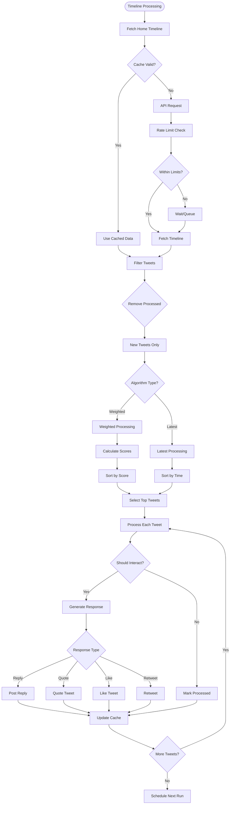
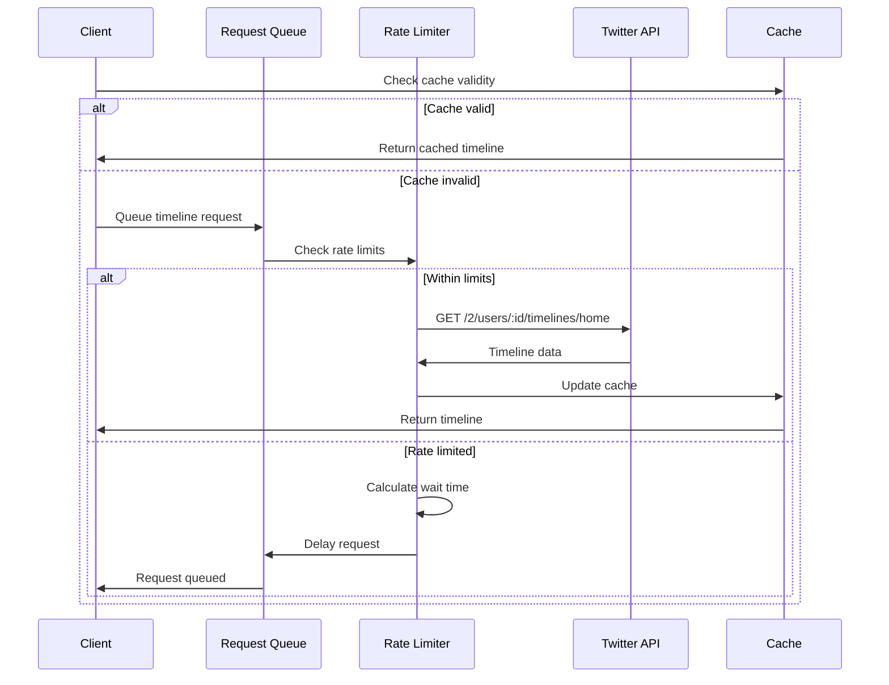
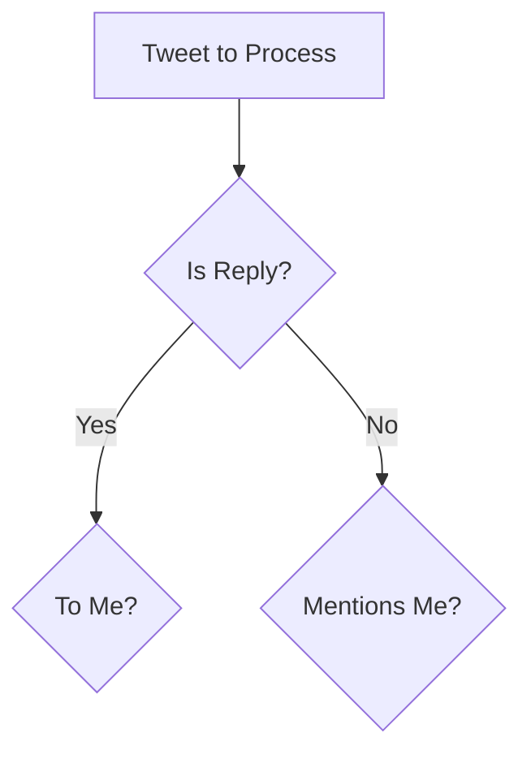

# a7046c18:packages_docs_plugin-registry_platform_twitter_timeline-flow.mdx:1-150

**Commit:** a7046c1843f76b29f0432654f631f950f18a4390
**Author:** lalalune
**Date:** Thu Jan 8 23:05:40 2026 -0800
**File:** packages/docs/plugin-registry/platform/twitter/timeline-flow.mdx:1-150
**Novelty Score:** 23659.22
**Concepts:** agent-system, authentication, blockchain, cache, containerization, documentation, embedded-db, event-driven, llm-integration, orchestration, performance, plugin-system, postgres, prompt-engineering, rag-system, rust-async, security, testing

```
---
title: "Timeline Flow"
description: "This document provides a comprehensive breakdown of how the Twitter plugin processes timeline data and generates interactions."
---

This document provides a comprehensive breakdown of how the Twitter plugin processes timeline data and generates interactions.

## Complete Timeline Flow Diagram



## Detailed Processing Flows

### 1. Timeline Fetching



### 2. Weighted Algorithm Flow

```mermaid
flowchart TD
    A[Tweet List] --> B[For Each Tweet]
    
    B --> C[Calculate User Score]
    C --> D{Target User?}
    D -->|Yes| E[Score = 10]
    D -->|No| F[Base Score = 5]
    
    F --> G{Verified?}
    G -->|Yes| H[Score +2]
    G -->|No| I[Continue]
    
    H --> J{High Followers?}
    I --> J
    J -->|Yes| K[Score +1]
    J -->|No| L[Continue]
    
    K --> M[User Score Complete]
    L --> M
    E --> M
    
    B --> N[Calculate Time Score]
    N --> O[Age in Hours]
    O --> P[Score = 10 - (Age/2)]
    P --> Q[Cap at 0-10]
    
    B --> R[Calculate Relevance]
    R --> S[Analyze Content]
    S --> T{Keywords Match?}
    T -->|Yes| U[High Relevance]
    T -->|No| V[Low Relevance]
    
    U --> W[Relevance Score]
    V --> W
    
    M --> X[Combine Scores]
    Q --> X
    W --> X
    
    X --> Y[Final Score = (U*3 + T*2 + R*5)]
    Y --> Z[Add to Scored List]
```

### 3. Interaction Decision Flow

