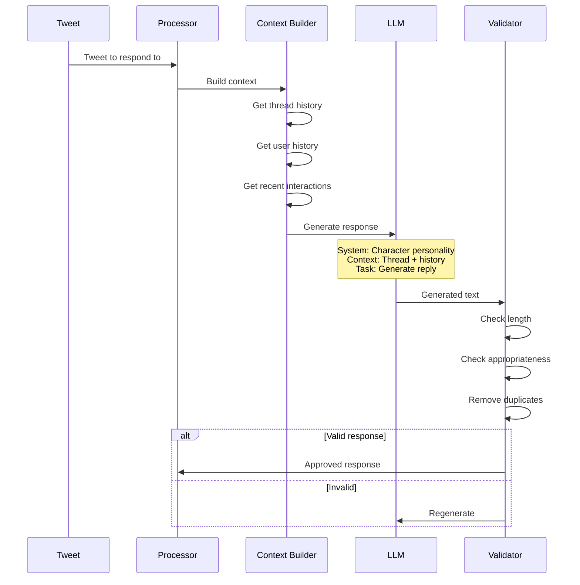
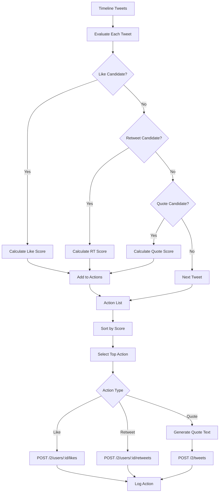

# a7046c18:packages_docs_plugin-registry_platform_twitter_timeline-flow.mdx:151-300

**Commit:** a7046c1843f76b29f0432654f631f950f18a4390
**Author:** lalalune
**Date:** Thu Jan 8 23:05:40 2026 -0800
**File:** packages/docs/plugin-registry/platform/twitter/timeline-flow.mdx:151-300
**Novelty Score:** 23659.22
**Concepts:** agent-system, authentication, blockchain, cache, containerization, documentation, embedded-db, event-driven, llm-integration, orchestration, performance, plugin-system, postgres, prompt-engineering, rag-system, rust-async, security, testing

```
    
    C -->|Yes| E[Should Reply = Yes]
    C -->|No| F{In Thread?}
    
    D -->|Yes| E
    D -->|No| G{Target User?}
    
    F -->|Yes| H[Check Context]
    F -->|No| I[Skip]
    
    G -->|Yes| J[Check Relevance]
    G -->|No| K{High Score?}
    
    H --> L{Relevant?}
    L -->|Yes| E
    L -->|No| I
    
    J --> M{Above Threshold?}
    M -->|Yes| E
    M -->|No| I
    
    K -->|Yes| N[Maybe Reply]
    K -->|No| I
    
    E --> O[Generate Response]
    N --> P[Probability Check]
    P --> Q{Random < 0.3?}
    Q -->|Yes| O
    Q -->|No| I
```

### 4. Response Generation Flow



### 5. Action Processing Flow



## Timeline State Management

### Cache Structure

```typescript
interface TimelineCache {
  tweets: Tweet[];
  users: Map<string, TwitterUser>;
  timestamp: number;
  etag?: string;
}

interface ProcessingState {
  processedTweets: Set<string>;
  lastProcessTime: number;
  interactionCount: number;
  rateLimitStatus: RateLimitInfo;
}
```

### Scoring Components

```typescript
interface ScoringWeights {
  user: number;      // Default: 3
  time: number;      // Default: 2
  relevance: number; // Default: 5
}

interface TweetScore {
  tweetId: string;
  userScore: number;
  timeScore: number;
  relevanceScore: number;
  totalScore: number;
  factors: {
    isTargetUser: boolean;
    isVerified: boolean;
    followerCount: number;
    hasKeywords: boolean;
    age: number;
  };
}
```

## Error Handling in Timeline Flow
```