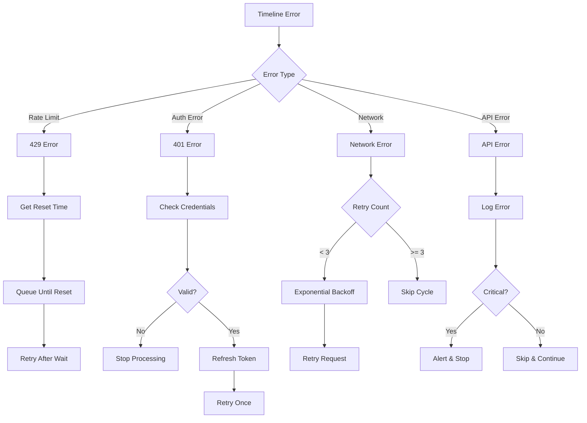
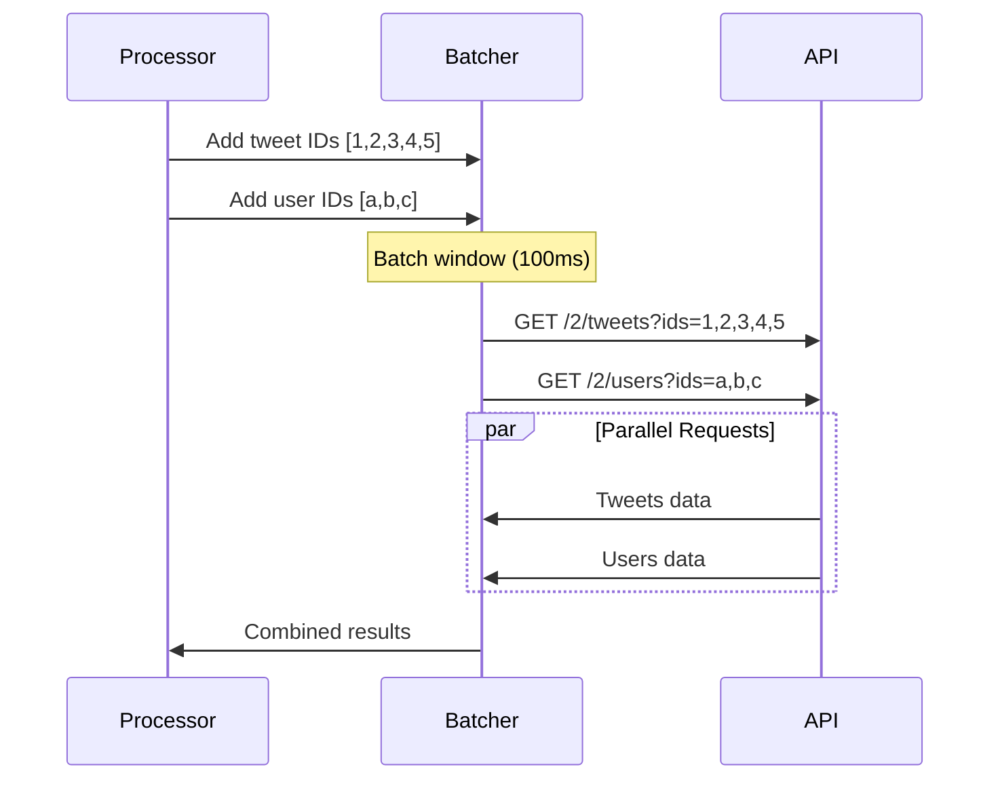
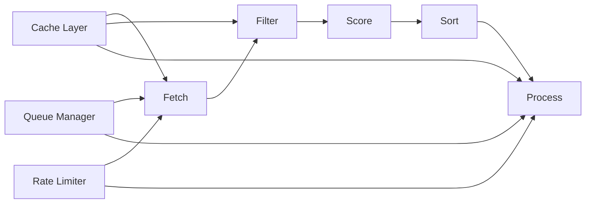
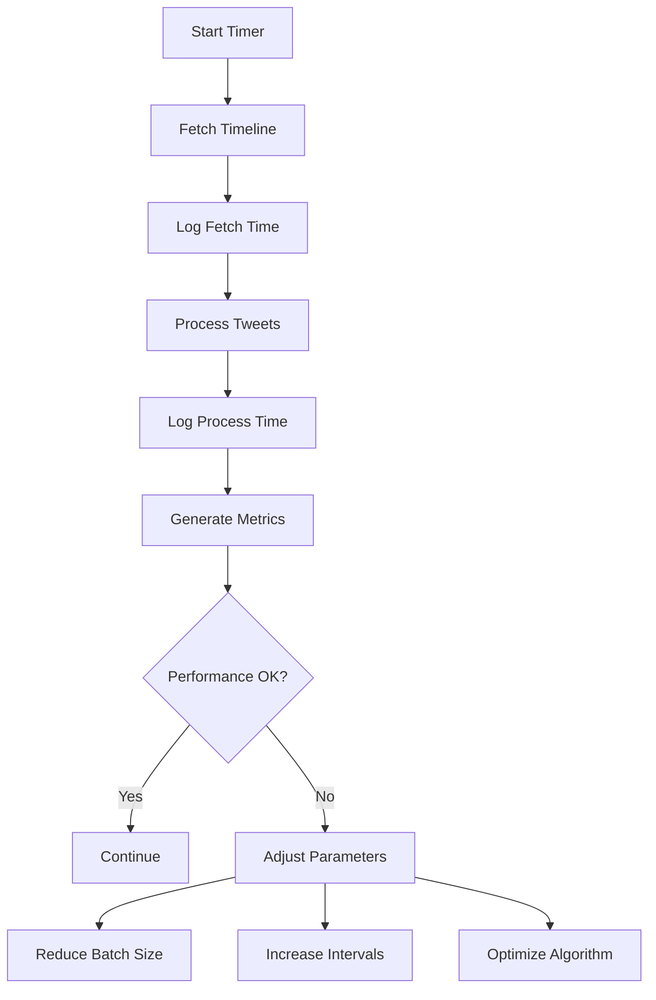
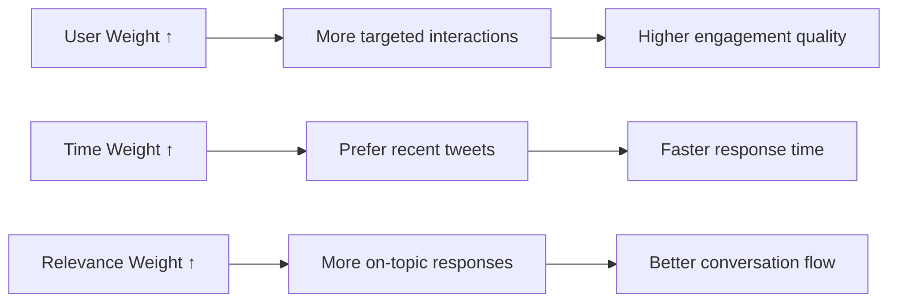

# a7046c18:packages_docs_plugin-registry_platform_twitter_timeline-flow.mdx:301-450

**Commit:** a7046c1843f76b29f0432654f631f950f18a4390
**Author:** lalalune
**Date:** Thu Jan 8 23:05:40 2026 -0800
**File:** packages/docs/plugin-registry/platform/twitter/timeline-flow.mdx:301-450
**Novelty Score:** 23659.22
**Concepts:** agent-system, authentication, blockchain, cache, containerization, documentation, embedded-db, event-driven, llm-integration, orchestration, performance, plugin-system, postgres, prompt-engineering, rag-system, rust-async, security, testing

```



## Performance Optimization

### Batch Processing



### Processing Pipeline



## Monitoring & Metrics

### Timeline Processing Metrics

```typescript
interface TimelineMetrics {
  fetchTime: number;
  tweetCount: number;
  newTweetCount: number;
  processedCount: number;
  interactionCount: number;
  errorCount: number;
  cacheHitRate: number;
  averageScore: number;
}
```

### Performance Tracking



## Configuration Impact

### Algorithm Selection

| Algorithm | Best For | Performance | Quality |
|-----------|----------|-------------|---------|
| Weighted | Quality interactions | Slower | Higher |
| Latest | High volume | Faster | Lower |

### Weight Configuration Effects



## Best Practices

1. **Cache Management**
   - Implement TTL for timeline cache
   - Clear processed tweets periodically
   - Monitor cache hit rates

2. **Rate Limit Handling**
   - Track limits per endpoint
   - Implement request queuing
   - Use exponential backoff

3. **Score Tuning**
```