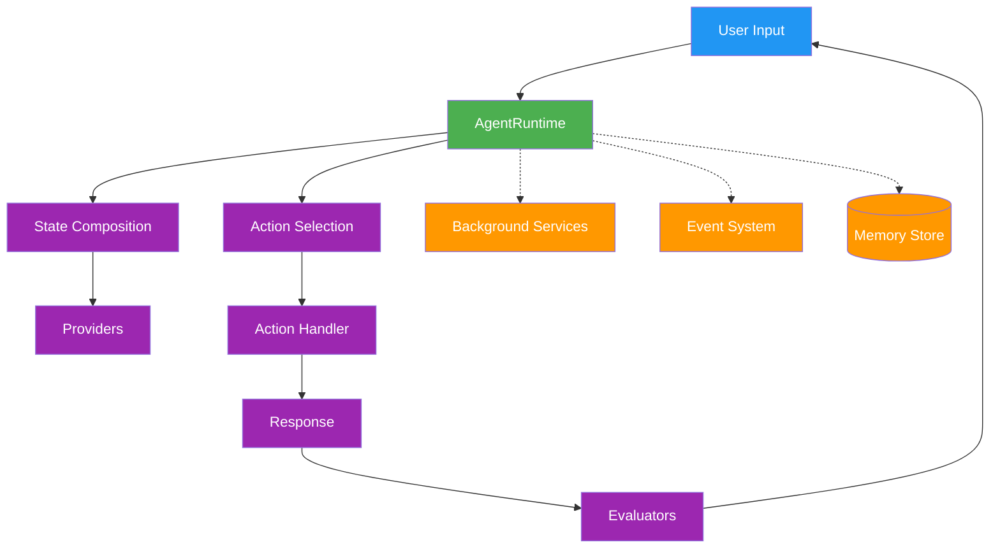

# a7046c18:packages_docs_runtime_core.mdx:151-300

**Commit:** a7046c1843f76b29f0432654f631f950f18a4390
**Author:** lalalune
**Date:** Thu Jan 8 23:05:40 2026 -0800
**File:** packages/docs/runtime/core.mdx:151-300
**Novelty Score:** 23659.22
**Concepts:** agent-system, authentication, blockchain, cache, containerization, documentation, embedded-db, event-driven, llm-integration, orchestration, performance, plugin-system, postgres, prompt-engineering, rag-system, rust-async, security, testing

```

// Multiple by names
const team = elizaOS.getAgentsByNames(['Researcher', 'Writer']);
```

### Events

ElizaOS extends `EventTarget` for lifecycle events:

```typescript
elizaOS.addEventListener('agent:started', (e) => {
  console.log(`Agent ${e.detail.agentId} started`);
});

elizaOS.addEventListener('message:sent', (e) => {
  console.log(`Message ${e.detail.messageId} sent in ${e.detail.mode} mode`);
});

// Available events:
// agent:added, agent:started, agent:stopped, agent:deleted
// agents:added, agents:started, agents:stopped, agents:deleted
// agent:registered, agent:updated
// message:sent, messages:sent
// mode:editable
```

### Health Monitoring

```typescript
// Check agent health
const health = await elizaOS.healthCheck();
// Map<UUID, { alive: boolean, responsive: boolean, memoryUsage?: number, uptime?: number }>

// Validate API keys
const keyStatus = await elizaOS.validateApiKeys();
// Map<UUID, boolean>
```

---

## What You Get

| Feature | Without ElizaOS | With ElizaOS |
|---------|-----------------|--------------|
| **Plugin resolution** | Manual imports, version conflicts | Auto-discovery, dependency ordering |
| **Database setup** | 50+ lines boilerplate | Zero-config SQLite or Postgres |
| **Multi-agent** | Build coordination from scratch | `handleMessages([...])` |
| **Streaming** | Implement SSE/WebSocket yourself | Built-in with callbacks |
| **State management** | Manual context threading | Automatic composition |
| **Platform integration** | Custom adapters per platform | Plugin ecosystem |

---

## System Architecture

The elizaOS runtime follows a modular, plugin-based architecture that orchestrates all agent functionality. For lifecycle details, see [Runtime and Lifecycle](/agents/runtime-and-lifecycle). For extension architecture, see [Plugin Architecture](/plugins/architecture).



### Core Components

The runtime orchestrates these essential components:

- **AgentRuntime**: Central orchestrator managing agent lifecycle
- **Plugin System**: Extends functionality through modular components
- **Memory System**: Hierarchical storage for conversations and knowledge
- **State Management**: Aggregates context from multiple sources 
- **Service Layer**: Background processes and integrations

For related documentation, see [Plugin Architecture](/plugins/architecture), [Memory](/runtime/memory), and [Services](/runtime/services).

## AgentRuntime Class

The `AgentRuntime` class is the central engine that manages agent lifecycle, processes messages, and coordinates all system components.

### Core Interface

```typescript
interface IAgentRuntime extends IDatabaseAdapter {
  // Core properties
  agentId: UUID;
  character: Character;
  providers: Provider[];
  actions: Action[];
  evaluators: Evaluator[];
  services: Service[];
  
  // Action processing
  processActions(message: Memory, responses: Memory[], state?: State): Promise<void>;
  composeState(message: Memory, state?: State): Promise<State>;
  evaluate(message: Memory, state?: State): Promise<void>;
  
  // Component registration
  registerAction(action: Action): void;
  registerProvider(provider: Provider): void;
  registerEvaluator(evaluator: Evaluator): void;
  registerService(service: Service): void;
  
  // Service management
  getService<T>(name: ServiceType): T;
  stop(): Promise<void>;
  
  // Model management
  useModel<T extends ModelTypeName>(modelType: T, params: ModelParamsMap[T], provider?: string): Promise<ModelResultMap[T]>;
  registerModel(modelType: ModelTypeName, handler: ModelHandler, provider?: string, priority?: number): void;
  getModel(modelType: ModelTypeName, provider?: string): ModelHandler | undefined;
  
  // Event system
  emit(eventType: EventType, data: any): Promise<void>;
  on(eventType: EventType, handler: EventHandler): void;
}
```

### Key Responsibilities

#### 1. Action Processing

The runtime orchestrates action selection and execution:

```typescript
async processActions(message: Memory, responses: Memory[], state?: State): Promise<void> {
  // Select and execute actions based on context
  const actions = await this.selectActions(message, state);
  
  for (const action of actions) {
    await action.handler(this, message, state);
```