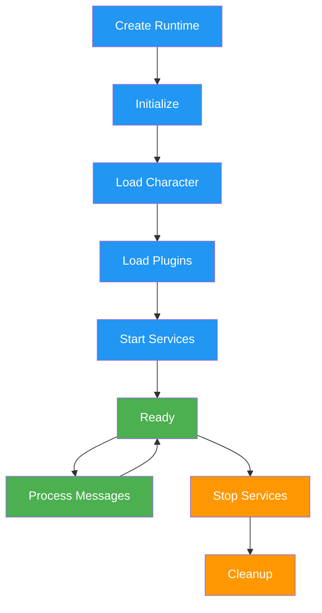

# a7046c18:packages_docs_runtime_core.mdx:301-450

**Commit:** a7046c1843f76b29f0432654f631f950f18a4390
**Author:** lalalune
**Date:** Thu Jan 8 23:05:40 2026 -0800
**File:** packages/docs/runtime/core.mdx:301-450
**Novelty Score:** 23659.22
**Concepts:** agent-system, authentication, blockchain, cache, containerization, documentation, embedded-db, event-driven, llm-integration, orchestration, performance, plugin-system, postgres, prompt-engineering, rag-system, rust-async, security, testing

```
  }
  
  // Run evaluators on results
  await this.evaluate(message, state);
}
```

#### 2. State Composition

Builds comprehensive context by aggregating data from providers:

```typescript
async composeState(message: Memory): Promise<State> {
  const state = {};
  
  for (const provider of this.providers) {
    const data = await provider.get(this, message, state);
    Object.assign(state, data);
  }
  
  return state;
}
```

#### 3. Plugin Management

Registers and initializes plugin components:

```typescript
async registerPlugin(plugin: Plugin) {
  // Register components
  plugin.actions?.forEach(a => this.registerAction(a));
  plugin.providers?.forEach(p => this.registerProvider(p));
  plugin.evaluators?.forEach(e => this.registerEvaluator(e));
  plugin.services?.forEach(s => this.registerService(s));
  
  // Initialize plugin
  await plugin.init?.(this.config, this);
}
```

## Runtime Lifecycle



### Initialization Sequence

1. **Runtime Creation**: Instantiate with character and configuration
2. **Character Loading**: Load agent personality and settings
3. **Plugin Loading**: Register plugins in dependency order
4. **Service Startup**: Initialize background services
5. **Ready State**: Agent ready to process messages

### Plugin Loading Order

```typescript
// Plugin priority determines load order
const pluginLoadOrder = [
  databases,      // Priority: -100
  modelProviders, // Priority: -50
  corePlugins,    // Priority: 0
  features,       // Priority: 50
  platforms       // Priority: 100
];
```

## Configuration

### Runtime Configuration

The runtime accepts configuration through multiple sources:

```typescript
interface RuntimeConfig {
  character: Character;
  plugins: Plugin[];
  database?: DatabaseConfig;
  models?: ModelConfig;
  services?: ServiceConfig;
  environment?: EnvironmentConfig;
}
```

### Environment Variables

Core runtime environment variables:

- `NODE_ENV` - Runtime environment (development/production)
- `LOG_LEVEL` - Logging verbosity
- `DATABASE_URL` - Database connection string
- `API_PORT` - Server port for API endpoints
- `AGENT_ID` - Unique agent identifier

### Settings Management

Access configuration through the runtime:

```typescript
// Get setting with fallback
const apiKey = runtime.getSetting("API_KEY");

// Check if setting exists
if (runtime.hasSetting("FEATURE_FLAG")) {
  // Feature is enabled
}
```

## Database Abstraction

The runtime implements `IDatabaseAdapter` for data persistence:

```typescript
interface IDatabaseAdapter {
  // Memory operations
  createMemory(memory: Memory): Promise<void>;
  searchMemories(query: string, limit?: number): Promise<Memory[]>;
  getMemoryById(id: UUID): Promise<Memory | null>;
  
  // Entity management
  createEntity(entity: Entity): Promise<void>;
  updateEntity(entity: Entity): Promise<void>;
  getEntity(id: UUID): Promise<Entity | null>;
  
  // Relationships
  createRelationship(rel: Relationship): Promise<void>;
  getRelationships(entityId: UUID): Promise<Relationship[]>;
  
  // Facts and knowledge
  createFact(fact: Fact): Promise<void>;
  searchFacts(query: string): Promise<Fact[]>;
}
```