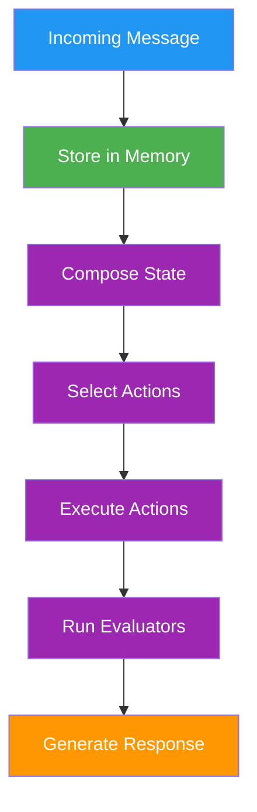

# a7046c18:packages_docs_runtime_core.mdx:451-600

**Commit:** a7046c1843f76b29f0432654f631f950f18a4390
**Author:** lalalune
**Date:** Thu Jan 8 23:05:40 2026 -0800
**File:** packages/docs/runtime/core.mdx:451-600
**Novelty Score:** 23659.22
**Concepts:** agent-system, authentication, blockchain, cache, containerization, documentation, embedded-db, event-driven, llm-integration, orchestration, performance, plugin-system, postgres, prompt-engineering, rag-system, rust-async, security, testing

```
```

### Memory Operations

```typescript
// Store a message
await runtime.createMemory({
  type: MemoryType.MESSAGE,
  content: { text: "User message" },
  roomId: message.roomId,
  userId: message.userId
});

// Search memories
const memories = await runtime.searchMemories(
  "previous conversation",
  10 // limit
);

// Get specific memory
const memory = await runtime.getMemoryById(memoryId);
```

## Message Processing Pipeline

The runtime processes messages through a defined pipeline:



### Processing Steps

1. **Message Receipt**: Receive and validate incoming message
2. **Memory Storage**: Persist message to database
3. **State Composition**: Build context from providers
4. **Action Selection**: Choose appropriate actions
5. **Action Execution**: Run selected action handlers
6. **Evaluation**: Post-process results
7. **Response Generation**: Create and send response

## Error Handling

The runtime implements comprehensive error handling:

```typescript
try {
  await runtime.processActions(message, responses, state);
} catch (error) {
  if (error instanceof ActionError) {
    // Handle action-specific errors
    runtime.logger.error("Action failed:", error);
  } else if (error instanceof StateError) {
    // Handle state composition errors
    runtime.logger.error("State error:", error);
  } else {
    // Handle unexpected errors
    runtime.logger.error("Unexpected error:", error);
    // Optionally trigger recovery
  }
}
```

## Performance Considerations

### State Caching

The runtime caches composed state for performance:

```typescript
// State is cached by message ID
const state = await runtime.composeState(message);
// Subsequent calls use cache
const cachedState = await runtime.composeState(message);
```

### Service Pooling

Services are singleton instances shared across the runtime:

```typescript
// Services are created once and reused
const service = runtime.getService(ServiceType.DATABASE);
// Same instance returned
const sameService = runtime.getService(ServiceType.DATABASE);
```

## Best Practices

### Runtime Initialization

- Initialize plugins in dependency order
- Start services after all plugins are loaded
- Verify character configuration before starting
- Set up error handlers before processing

### Resource Management

- Clean up services on shutdown
- Clear state cache periodically
- Monitor memory usage
- Implement connection pooling

### Error Recovery

- Implement retry logic for transient failures
- Log errors with context
- Gracefully degrade functionality
- Maintain audit trail

## Integration Points

The runtime provides multiple integration points:

- **Plugins**: Extend functionality through the plugin system
- **Events**: React to runtime events
- **Services**: Add background processes
- **Models**: Integrate AI providers
- **Database**: Custom database adapters
- **API**: HTTP endpoints through routes

## Advanced Runtime Methods

Beyond the core interface, the runtime exposes additional methods for advanced use cases.

### Run Tracking

Track agent execution runs for debugging, analytics, and action chaining:

```typescript
interface IAgentRuntime {
  // Create a unique run identifier
  createRunId(): UUID;

```