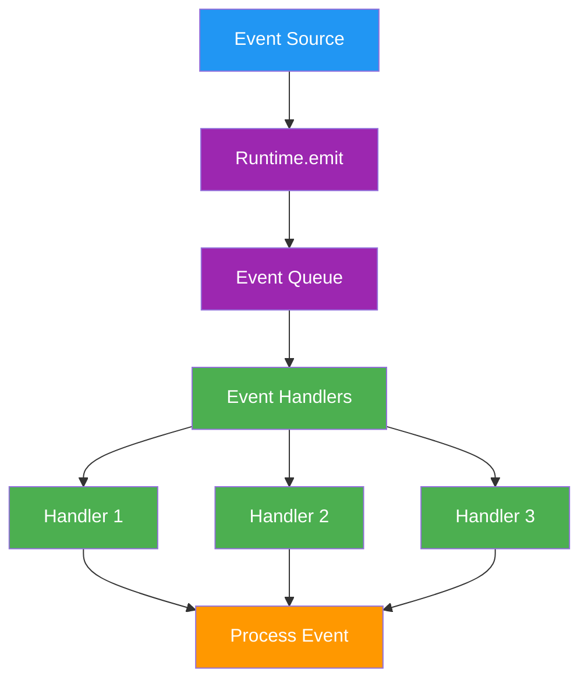

# a7046c18:packages_docs_runtime_events.mdx:1-150

**Commit:** a7046c1843f76b29f0432654f631f950f18a4390
**Author:** lalalune
**Date:** Thu Jan 8 23:05:40 2026 -0800
**File:** packages/docs/runtime/events.mdx:1-150
**Novelty Score:** 23659.22
**Concepts:** agent-system, authentication, blockchain, cache, containerization, documentation, embedded-db, event-driven, llm-integration, orchestration, performance, plugin-system, postgres, prompt-engineering, rag-system, rust-async, security, testing

```
---
title: "Events"
description: "React to everything your agent does - messages, actions, model calls, and more"
---

## Why Events?

Your agent does a lot behind the scenes. Events let you **hook into every step**:

- Log every model call for debugging
- Track action success/failure for analytics
- Trigger workflows when messages arrive
- Monitor agent health in real-time

<Tip>
**Events are fire-and-forget.** Handlers run asynchronously and don't block the main flow.
</Tip>

## Event System

The event system enables reactive programming patterns, allowing plugins and services to respond to runtime activities. Events flow through the system providing hooks for custom logic and integrations.

## Event Architecture



## Event Types

### Core Event Types

```typescript
enum EventType {
  // World events
  WORLD_JOINED = 'world:joined',
  WORLD_CONNECTED = 'world:connected',
  WORLD_LEFT = 'world:left',
  
  // Entity events
  ENTITY_JOINED = 'entity:joined',
  ENTITY_LEFT = 'entity:left',
  ENTITY_UPDATED = 'entity:updated',
  
  // Room events
  ROOM_JOINED = 'room:joined',
  ROOM_LEFT = 'room:left',
  ROOM_UPDATED = 'room:updated',
  
  // Message events
  MESSAGE_RECEIVED = 'message:received',
  MESSAGE_SENT = 'message:sent',
  MESSAGE_DELETED = 'message:deleted',
  MESSAGE_UPDATED = 'message:updated',
  
  // Voice events
  VOICE_MESSAGE_RECEIVED = 'voice:message:received',
  VOICE_MESSAGE_SENT = 'voice:message:sent',
  VOICE_STARTED = 'voice:started',
  VOICE_ENDED = 'voice:ended',
  
  // Run events
  RUN_STARTED = 'run:started',
  RUN_COMPLETED = 'run:completed',
  RUN_FAILED = 'run:failed',
  RUN_TIMEOUT = 'run:timeout',
  
  // Action events
  ACTION_STARTED = 'action:started',
  ACTION_COMPLETED = 'action:completed',
  ACTION_FAILED = 'action:failed',
  
  // Evaluator events
  EVALUATOR_STARTED = 'evaluator:started',
  EVALUATOR_COMPLETED = 'evaluator:completed',
  EVALUATOR_FAILED = 'evaluator:failed',
  
  // Model events
  MODEL_USED = 'model:used',
  MODEL_FAILED = 'model:failed',
  
  // Service events
  SERVICE_STARTED = 'service:started',
  SERVICE_STOPPED = 'service:stopped',
  SERVICE_ERROR = 'service:error'
}
```

## Event Payloads

### Payload Interfaces

Each event type has a specific payload structure:

```typescript
// Message event payload
interface MessagePayload {
  runtime: IAgentRuntime;
  message: Memory;
  room?: Room;
  user?: User;
  callback?: ResponseCallback;
}

// World event payload
interface WorldPayload {
  runtime: IAgentRuntime;
  world: World;
  metadata?: Record<string, any>;
}

// Entity event payload
interface EntityPayload {
  runtime: IAgentRuntime;
  entity: Entity;
  action: 'joined' | 'left' | 'updated';
  changes?: Partial<Entity>;
}

// Action event payload
interface ActionPayload {
  runtime: IAgentRuntime;
  action: Action;
  message: Memory;
  state: State;
  result?: any;
  error?: Error;
}

// Model event payload
interface ModelPayload {
```