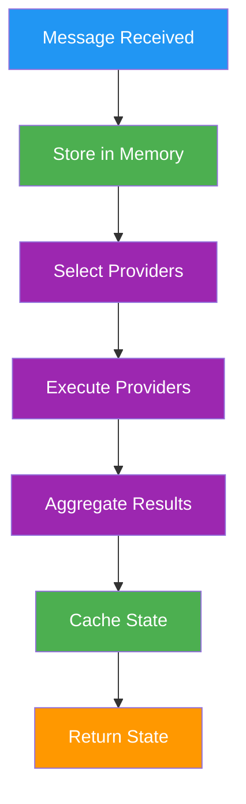

# a7046c18:packages_docs_runtime_memory.mdx:1-150

**Commit:** a7046c1843f76b29f0432654f631f950f18a4390
**Author:** lalalune
**Date:** Thu Jan 8 23:05:40 2026 -0800
**File:** packages/docs/runtime/memory.mdx:1-150
**Novelty Score:** 23659.22
**Concepts:** agent-system, authentication, blockchain, cache, containerization, documentation, embedded-db, event-driven, llm-integration, orchestration, performance, plugin-system, postgres, prompt-engineering, rag-system, rust-async, security, testing

```
---
title: "Memory & State"
description: "Give your agent a brain that remembers, learns, and evolves"
---

## Why Memory Matters

An AI without memory is like a goldfish - every conversation starts from zero. Your users expect agents that:

- **Remember context** - "As we discussed yesterday..."
- **Learn preferences** - "You mentioned you prefer TypeScript..."
- **Build knowledge** - Facts extracted from conversations persist

<Tip>
**Memory is your agent's brain.** Messages, facts, relationships, goals - all stored, indexed, and searchable through embeddings.
</Tip>

## Memory System

The memory system provides hierarchical storage for conversations, knowledge, and agent state. It enables agents to maintain context, learn from interactions, and build persistent knowledge.

<CardGroup cols={2}>
  <Card title="Conceptual Overview" icon="brain" href="/agents/memory-and-state">
    Understanding memory architecture
  </Card>
  <Card title="Runtime Core" icon="microchip" href="/runtime/core">
    How memory integrates with the runtime
  </Card>
</CardGroup>

## Memory Types

### Core Memory Types

```typescript
enum MemoryType {
  MESSAGE = 'message',           // Conversation messages
  FACT = 'fact',                // Extracted knowledge
  DOCUMENT = 'document',         // Document storage
  RELATIONSHIP = 'relationship', // Entity relationships
  GOAL = 'goal',                // Agent goals
  TASK = 'task',                // Scheduled tasks
  ACTION = 'action',            // Action execution records
}
```

### Memory Interface

```typescript
interface Memory {
  id: UUID;
  type: MemoryType;
  roomId: UUID;
  userId?: UUID;
  agentId?: UUID;
  content: {
    text: string;
    [key: string]: any;
  };
  embedding?: number[];
  createdAt: Date;
  updatedAt?: Date;
  metadata?: Record<string, any>;
}
```

## State Management

### State Structure

State represents the agent's current understanding of context:

```typescript
interface State {
  // Key-value pairs for template access
  values: Record<string, any>;
  
  // Structured data from providers
  data: Record<string, any>;
  
  // Concatenated textual context
  text: string;
}
```

### State Composition Pipeline



## Memory Operations

### Creating Memories

```typescript
// Store a message
await runtime.createMemory({
  type: MemoryType.MESSAGE,
  content: { 
    text: "User message",
    role: 'user',
    name: 'John'
  },
  roomId: message.roomId,
  userId: message.userId,
  metadata: {
    platform: 'discord',
    channelId: '12345'
  }
});

// Store a fact
await runtime.createMemory({
  type: MemoryType.FACT,
  content: {
    text: "The user's favorite color is blue",
    subject: 'user',
    predicate: 'favorite_color',
    object: 'blue'
  },
  roomId: message.roomId
});

// Store an action result
await runtime.createMemory({
  type: MemoryType.ACTION,
  content: {
    text: "Generated image of a sunset",
    action: 'IMAGE_GENERATION',
    result: { url: 'https://...' }
  },
  roomId: message.roomId,
  agentId: runtime.agentId
```