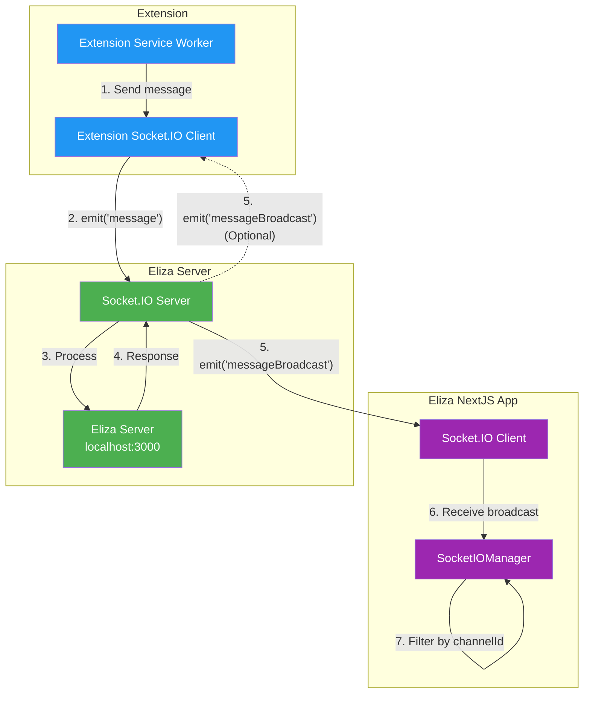

# a7046c18:packages_docs_runtime_messaging.mdx:1-150

**Commit:** a7046c1843f76b29f0432654f631f950f18a4390
**Author:** lalalune
**Date:** Thu Jan 8 23:05:40 2026 -0800
**File:** packages/docs/runtime/messaging.mdx:1-150
**Novelty Score:** 23659.22
**Concepts:** agent-system, authentication, blockchain, cache, containerization, documentation, embedded-db, event-driven, llm-integration, orchestration, performance, plugin-system, postgres, prompt-engineering, rag-system, rust-async, security, testing

```
---
title: "Messaging"
description: "Real-time messaging infrastructure and Socket.IO integration"
---

## Overview

The messaging infrastructure provides real-time communication between clients and the ElizaOS server using Socket.IO. This enables instant message delivery, presence tracking, and bidirectional communication.

## Architecture

### How WebSockets Work in ElizaOS

The project uses **Socket.IO** (not raw WebSockets) for real-time communication between clients and the Eliza server.



### Key Components

1. **Direct Connection**: Socket.IO connects directly to the Eliza server (default: `http://localhost:3000`)
2. **Channel-Based Communication**: Messages are organized by channels (or rooms for backward compatibility)
3. **Message Filtering**: Clients filter incoming broadcasts by channel/room ID

## Socket.IO Events and Message Types

### Message Types Enum

```javascript
enum SOCKET_MESSAGE_TYPE {
  ROOM_JOINING = 1,      // Join a channel/room
  SEND_MESSAGE = 2,      // Send a message
  MESSAGE = 3,           // Generic message
  ACK = 4,              // Acknowledgment
  THINKING = 5,         // Agent is thinking
  CONTROL = 6           // Control messages
}
```

### Key Events

- `messageBroadcast` - Incoming messages from agents/users
- `messageComplete` - Message processing complete
- `controlMessage` - UI control (enable/disable input)
- `connection_established` - Connection confirmed

## Socket.IO Client Implementation

### Minimal Socket.IO Client

Here's a minimal Socket.IO client implementation:

```javascript
const SOCKET_URL = 'http://localhost:3000';

// 1. Connect to Socket.IO
const socket = io(SOCKET_URL, {
  'force new connection': true,
  'reconnection': true,
  'reconnectionDelay': 1000,
  'reconnectionAttempts': 5,
  'timeout': 20000,
  'transports': ['polling', 'websocket']
});

// Your IDs (make sure these match exactly)
const entityId = 'your-entity-id';
const roomId = 'your-room-id'; // This should match the agent/channel ID

// 2. CRITICAL: Join the room when connected
socket.on('connect', function() {
  console.log('[SUCCESS] Connected to Eliza, socket ID:', socket.id);
  
  // JOIN THE ROOM - This is required to receive broadcasts!
  socket.emit('message', {
    type: 1, // ROOM_JOINING
    payload: {
      roomId: roomId,
      entityId: entityId
    }
  });
  
  console.log('[SENT] Room join request for room:', roomId);
});

// 3. LISTEN FOR THE CORRECT EVENT: "messageBroadcast" (not "message")
socket.on('messageBroadcast', function(data) {
  console.log('[RECEIVED] Broadcast:', data);
  
  // Check if this message is for your room
  if (data.roomId === roomId || data.channelId === roomId) {
    console.log('[SUCCESS] Message is for our room!');
    console.log('Sender:', data.senderName);
    console.log('Text:', data.text);
    console.log('Full data:', JSON.stringify(data, null, 2));
  } else {
    console.log('[ERROR] Message is for different room:', data.roomId || data.channelId);
  }
});

// 4. Listen for other important events
socket.on('messageComplete', function(data) {
  console.log('[SUCCESS] Message processing complete:', data);
});

socket.on('connection_established', function(data) {
  console.log('[SUCCESS] Connection established:', data);
});

// 5. Send a message (make sure format is exact)
function sendMessageToEliza(text) {
  const messagePayload = {
    type: 2, // SEND_MESSAGE
```