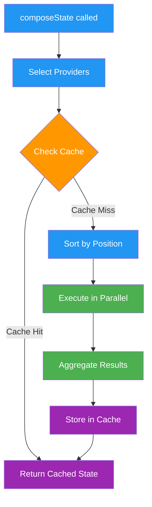

# a7046c18:packages_docs_runtime_providers.mdx:301-450

**Commit:** a7046c1843f76b29f0432654f631f950f18a4390
**Author:** lalalune
**Date:** Thu Jan 8 23:05:40 2026 -0800
**File:** packages/docs/runtime/providers.mdx:301-450
**Novelty Score:** 23659.22
**Concepts:** agent-system, authentication, blockchain, cache, containerization, documentation, embedded-db, event-driven, llm-integration, orchestration, performance, plugin-system, postgres, prompt-engineering, rag-system, rust-async, security, testing

```
```

### Provider Best Practices

1. **Return quickly**: Use timeouts for external calls
2. **Handle errors gracefully**: Return empty result on failure
3. **Keep data size reasonable**: Don't return excessive data
4. **Use appropriate flags**: Set `dynamic` for optional providers
5. **Consider position**: Order matters for dependent providers

### Provider Dependencies

Providers can access data from previously executed providers through the state parameter:

```typescript
const dependentProvider: Provider = {
  name: 'DEPENDENT',
  position: 200, // Runs after other providers
  
  get: async (runtime, message, state) => {
    // Access data from earlier providers
    const characterData = state?.data?.providers?.CHARACTER?.data;
    
    if (!characterData) {
      return { values: {}, data: {}, text: '' };
    }
    
    // Process based on character data
    const processed = processCharacterData(characterData);
    
    return {
      values: { processed: processed.summary },
      data: { processed },
      text: `Processed: ${processed.summary}`
    };
  }
};
```

## State Cache Management

### Cache Architecture

The runtime maintains an in-memory cache of composed states:

```typescript
// Cache is stored by message ID
this.stateCache.set(message.id, newState);
```

### Cache Usage

```typescript
// Use cached data (default behavior)
const cachedState = await runtime.composeState(message);

// Force fresh data
const freshState = await runtime.composeState(message, null, false, true);
```

### Cache Optimization

```typescript
// Clear old cache entries periodically
setInterval(() => {
  const fiveMinutesAgo = Date.now() - 5 * 60 * 1000;
  for (const [messageId, _] of runtime.stateCache.entries()) {
    runtime.getMemoryById(messageId).then((memory) => {
      if (memory && memory.createdAt < fiveMinutesAgo) {
        runtime.stateCache.delete(messageId);
      }
    });
  }
}, 60000); // Run every minute
```

## Provider Execution Flow



## Performance Optimization

### Parallel Execution

Providers run concurrently for optimal performance:

```typescript
const results = await Promise.all(
  providers.map(provider => 
    provider.get(runtime, message, partialState)
  )
);
```

### Timeout Handling

Implement timeouts to prevent slow providers from blocking:

```typescript
const timeoutProvider: Provider = {
  name: 'TIMEOUT_SAFE',
  get: async (runtime, message) => {
    const fetchData = async () => {
      // Potentially slow operation
      const data = await externalAPI.fetch();
      return formatProviderResult(data);
    };
    
    return Promise.race([
      fetchData(),
      new Promise((_, reject) => 
        setTimeout(() => reject(new Error('Timeout')), 5000)
      )
    ]).catch(error => {
      runtime.logger.warn(`Provider timeout: ${error.message}`);
      return { values: {}, data: {}, text: '' };
    });
  }
};
```

## Common Issues and Solutions

### Circular Dependencies

Avoid providers that depend on each other circularly:

```typescript
// BAD: Circular dependency
const providerA: Provider = {
```