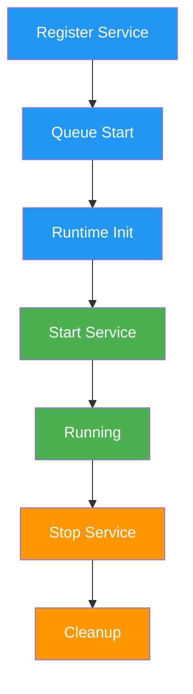

# a7046c18:packages_docs_runtime_services.mdx:1-150

**Commit:** a7046c1843f76b29f0432654f631f950f18a4390
**Author:** lalalune
**Date:** Thu Jan 8 23:05:40 2026 -0800
**File:** packages/docs/runtime/services.mdx:1-150
**Novelty Score:** 23659.22
**Concepts:** agent-system, authentication, blockchain, cache, containerization, documentation, embedded-db, event-driven, llm-integration, orchestration, performance, plugin-system, postgres, prompt-engineering, rag-system, rust-async, security, testing

```
---
title: "Services"
description: "Long-running connections, integrations, and background processes for your agent"
---

## Why Services?

Actions handle one-off tasks. But what about:
- **Persistent connections** to Discord, Telegram, databases?
- **Background jobs** like monitoring, cleanup, scheduling?
- **Shared resources** like connection pools, caches?

Services fill this gap. They start with your agent and run continuously.

<Tip>
**One instance per type.** Services are singletons - `getService('discord')` always returns the same instance.
</Tip>

## Available Service Types

| Service Type | Purpose | Plugin |
|--------------|---------|--------|
| `TRANSCRIPTION` | Audio → Text | `@elizaos/plugin-openai` |
| `VIDEO` | Video processing | `@elizaos/plugin-video` |
| `BROWSER` | Web automation | `@elizaos/plugin-browser` |
| `PDF` | PDF processing | `@elizaos/plugin-pdf` |
| `REMOTE_FILES` | AWS S3, cloud storage | `@elizaos/plugin-s3` |
| `WEB_SEARCH` | Search queries | `@elizaos/plugin-web-search` |
| `EMAIL` | Email sending | `@elizaos/plugin-email` |
| `TASK` | Background tasks | `@elizaos/core` |
| `WALLET` | Crypto wallets | `@elizaos/plugin-evm` |
| `MESSAGE_SERVICE` | Real-time messaging | `@elizaos/core` |

---

## Service System

Services are long-running background tasks that extend agent functionality beyond request-response patterns. They manage connections, handle events, and perform ongoing operations.

## Service Interface

### Abstract Service Class

```typescript
abstract class Service {
  static serviceType: ServiceType;
  
  constructor(runtime?: IAgentRuntime) {}
  
  abstract capabilityDescription: string;
  config?: ServiceConfig;
  
  static async start(runtime: IAgentRuntime): Promise<Service> {
    // Return new instance of service
  }
  
  abstract stop(): Promise<void>;
}
```

### Service Properties

- **serviceType**: Unique identifier for the service type
- **capabilityDescription**: Human-readable description of service capabilities
- **config**: Optional configuration object
- **start**: Static method to initialize and start the service
- **stop**: Instance method to gracefully shut down the service

## Service Types

### Core Service Types

The core package defines base service types:

```typescript
const ServiceType = {
  // Core services defined in @elizaos/core
  TASK: 'task',
  DATABASE: 'database',
  // ... other core types
} as const;
```

### Plugin Service Types

Plugins extend service types through module augmentation:

```typescript
// Plugin extends ServiceType through module augmentation
declare module '@elizaos/core' {
  interface ServiceTypeRegistry {
    DISCORD: 'discord';
    TELEGRAM: 'telegram';
    TWITTER: 'twitter';
    SEARCH: 'search';
    IMAGE_GENERATION: 'image_generation';
    TRANSCRIPTION: 'transcription';
    // ... other plugin-specific types
  }
}
```

## Service Lifecycle



### Lifecycle Phases

1. **Registration**: Service registered with runtime during plugin initialization
2. **Queuing**: Service queued for startup
3. **Initialization**: Runtime prepares service environment
4. **Start**: Service `start()` method called
5. **Running**: Service actively processing
6. **Stop**: Graceful shutdown initiated
7. **Cleanup**: Resources released

## Common Service Patterns

### Platform Integration Service

Services that connect to external platforms:

```typescript
class DiscordService extends Service {
  static serviceType = 'discord' as const;
  capabilityDescription = 'Discord bot integration';
  
  private client: Discord.Client;
  
  constructor(private runtime: IAgentRuntime) {
    super(runtime);
  }
  
  static async start(runtime: IAgentRuntime): Promise<Service> {
```