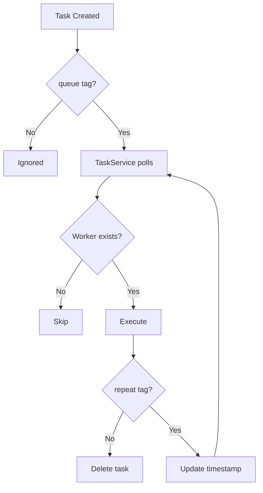

# a7046c18:packages_docs_runtime_services.mdx:901-1019

**Commit:** a7046c1843f76b29f0432654f631f950f18a4390
**Author:** lalalune
**Date:** Thu Jan 8 23:05:40 2026 -0800
**File:** packages/docs/runtime/services.mdx:901-1019
**Novelty Score:** 23659.22
**Concepts:** agent-system, authentication, blockchain, cache, containerization, documentation, embedded-db, event-driven, llm-integration, orchestration, performance, plugin-system, postgres, prompt-engineering, rag-system, rust-async, security, testing

```
  },

  execute: async (runtime, options, task) => {
    runtime.logger.info('Executing daily report task');

    // Do the work
    const report = await generateReport(runtime);
    await sendReport(report, options.recipientId);

    runtime.logger.info('Daily report sent');
  }
});
```

### Creating Tasks

```typescript
// One-time task (deleted after execution)
await runtime.createTask({
  name: 'SEND_DAILY_REPORT',
  description: 'Send daily analytics report',
  tags: ['queue'],                 // 'queue' = scheduled for execution
  metadata: {
    recipientId: 'user-123'
  }
});

// Recurring task (keeps running)
await runtime.createTask({
  name: 'SYNC_EXTERNAL_DATA',
  description: 'Sync data from external API every hour',
  tags: ['queue', 'repeat'],       // 'repeat' = don't delete after execution
  metadata: {
    updateInterval: 1000 * 60 * 60  // 1 hour
  }
});
```

### Task Execution Flow



### Task Tags

| Tag | Behavior |
|-----|----------|
| `queue` | Task is eligible for execution |
| `repeat` | Task persists after execution (recurring) |
| `immediate` | Execute as soon as possible |
| Custom tags | For filtering and organization |

### Runtime Task Methods

```typescript
// Create a task
const taskId = await runtime.createTask(task);

// Get tasks by criteria
const tasks = await runtime.getTasks({
  roomId: '...',
  tags: ['queue'],
  entityId: '...'
});

// Get specific task
const task = await runtime.getTask(taskId);

// Update task
await runtime.updateTask(taskId, {
  metadata: { ...task.metadata, lastResult: 'success' }
});

// Delete task
await runtime.deleteTask(taskId);

// Get/register workers
runtime.registerTaskWorker(worker);
const worker = runtime.getTaskWorker('TASK_NAME');
```

### Best Practices

- **Idempotent execution**: Tasks may run multiple times on failures
- **Error handling**: Catch errors in `execute()` to prevent task service crashes
- **Reasonable intervals**: Don't set `updateInterval` too low (< 1000ms)
- **Clean up**: Delete completed one-time tasks to avoid database bloat
- **Validation**: Use `validate()` to check preconditions before execution

## See Also

<CardGroup cols={2}>
  <Card title="Messaging" icon="message" href="/runtime/messaging">
    Build real-time messaging services
  </Card>

  <Card title="Sessions API" icon="comments" href="/runtime/sessions-api">
    Manage stateful conversations
  </Card>

  <Card title="Events" icon="bolt" href="/runtime/events">
    Handle service lifecycle events
  </Card>

  <Card title="Models" icon="robot" href="/runtime/models">
    Build model provider services
  </Card>
</CardGroup>
```