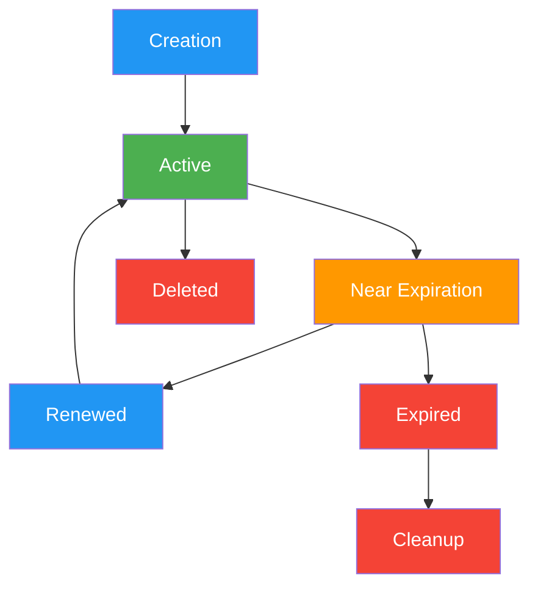

# a7046c18:packages_docs_runtime_sessions-api.mdx:1-150

**Commit:** a7046c1843f76b29f0432654f631f950f18a4390
**Author:** lalalune
**Date:** Thu Jan 8 23:05:40 2026 -0800
**File:** packages/docs/runtime/sessions-api.mdx:1-150
**Novelty Score:** 23659.22
**Concepts:** agent-system, authentication, blockchain, cache, containerization, documentation, embedded-db, event-driven, llm-integration, orchestration, performance, plugin-system, postgres, prompt-engineering, rag-system, rust-async, security, testing

```
---
title: "Sessions API"
description: "Complete API reference, architecture, implementation, and usage guide for the Sessions messaging system"
---

## Overview

The Sessions API provides a sophisticated abstraction layer over the traditional messaging infrastructure, enabling persistent, stateful conversations with automatic timeout management and renewal capabilities.

### Why Use Sessions?

The Sessions API **eliminates the complexity of channel management**. Traditional messaging approaches require you to:

1. Create or find a server
2. Create or find a channel within that server
3. Add agents to the channel
4. Manage channel participants
5. Handle channel lifecycle (creation, deletion, cleanup)

With Sessions API, you simply:
1. Create a session with an agent
2. Send messages
3. (Optional) Configure timeout and renewal policies

### Key Features

- **Zero Channel Management**: No need to create servers, channels, or manage participants
- **Instant Setup**: Start conversations immediately with just agent and user IDs
- **Automatic Timeout Management**: Sessions automatically expire after periods of inactivity
- **Session Renewal**: Support for both automatic and manual session renewal
- **Expiration Warnings**: Get notified when sessions are about to expire
- **Configurable Policies**: Customize timeout, renewal, and duration limits per session or agent
- **Resource Optimization**: Automatic cleanup of expired sessions to prevent memory leaks
- **Persistent Conversations**: Maintain chat history and context across multiple messages
- **State Management**: Track conversation stage, renewal count, and expiration status
- **Multi-Platform Support**: Works across different platforms with metadata support

## Sessions Architecture

### Core Design Principles

#### Abstraction Over Complexity

The Sessions API abstracts away channel and server management complexity:

```typescript
// Traditional approach (complex)
const server = await createServer({ name: 'My Server' });
const channel = await createChannel({ serverId: server.id });
await addAgentToServer(server.id, agentId);
await addAgentToChannel(channel.id, agentId);
await sendMessage(channel.id, { content: 'Hello' });

// Sessions approach (simple)
const { sessionId } = await createSession({ agentId, userId });
await sendSessionMessage(sessionId, { content: 'Hello' });
```

#### State Management

Sessions maintain state across multiple dimensions:

```typescript
interface Session {
  // Identity
  id: string;
  agentId: UUID;
  userId: UUID;
  channelId: UUID;
  
  // Temporal State
  createdAt: Date;
  lastActivity: Date;
  expiresAt: Date;
  
  // Configuration
  timeoutConfig: SessionTimeoutConfig;
  
  // Lifecycle State
  renewalCount: number;
  warningState?: {
    sent: boolean;
    sentAt: Date;
  };
  
  // Application State
  metadata: Record<string, any>;
}
```

## Session Lifecycle



### Lifecycle Phases

1. **Creation**: Initialize session with configuration
2. **Active**: Process messages and maintain state
3. **Near Expiration**: Warning state before timeout
4. **Renewed**: Lifetime extended (auto or manual)
5. **Expired**: Session exceeded timeout
6. **Deleted**: Explicit termination
7. **Cleanup**: Resource cleanup

## Timeout Configuration

### Configuration Interface

```typescript
interface SessionTimeoutConfig {
  timeoutMinutes?: number;           // Inactivity timeout (5-1440)
  autoRenew?: boolean;               // Auto-renew on activity
  maxDurationMinutes?: number;       // Maximum total duration
  warningThresholdMinutes?: number;  // Warning threshold
}
```

### Configuration Hierarchy

Configuration follows a three-tier precedence:

```typescript
// Priority Order (highest to lowest)
// 1. Session-specific config
// 2. Agent-specific config
// 3. Global defaults

const finalConfig = {
  ...globalDefaults,
  ...agentConfig,
  ...sessionConfig
```